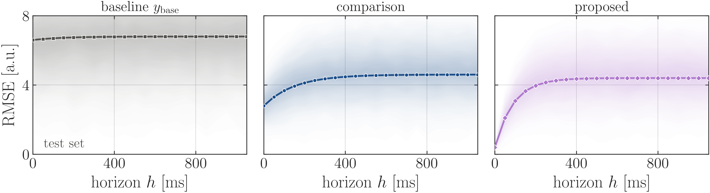
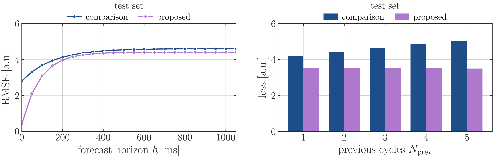
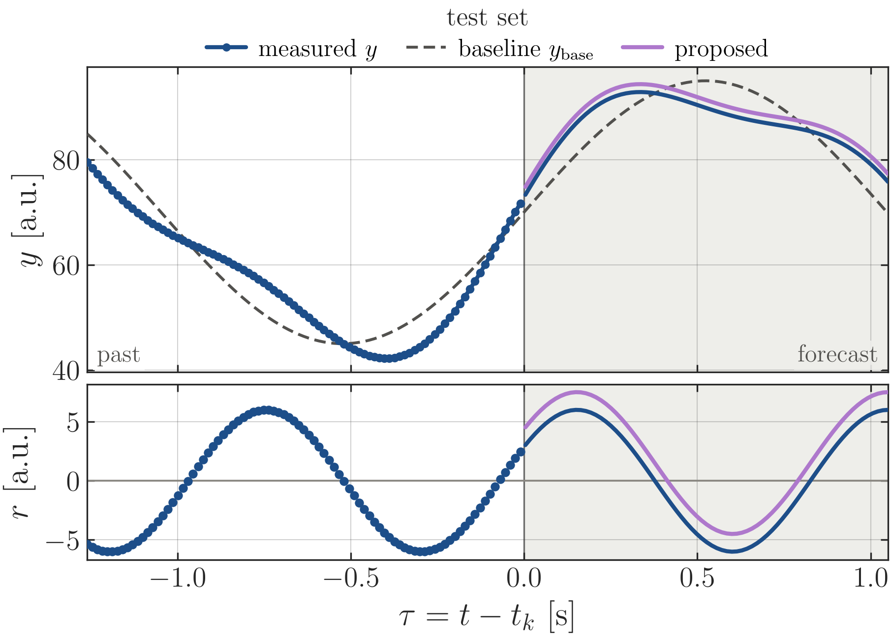
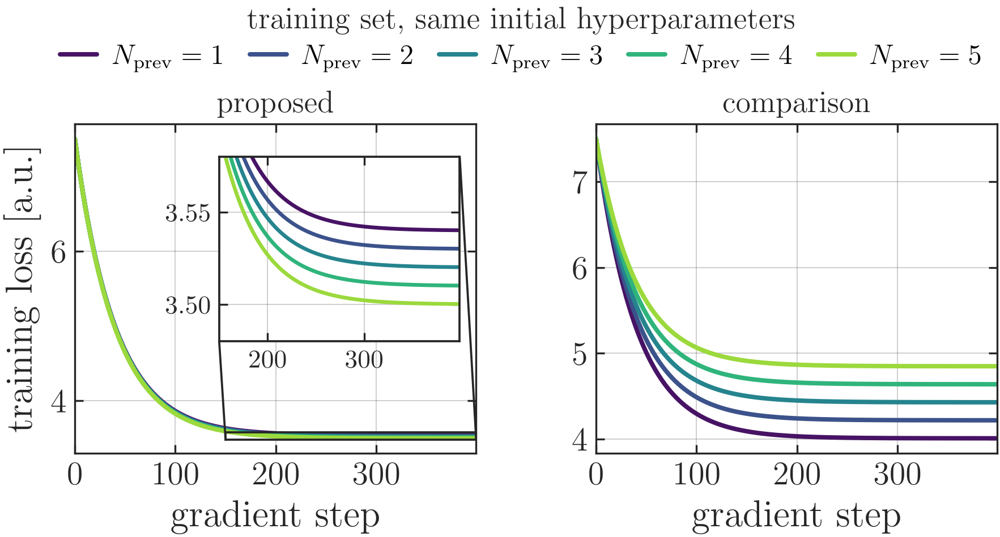

# Paper figure kit

Matplotlib figures for papers in one consistent style: LaTeX text, one colour per method kept across the paper,
boxed panels, vector PDF output. It draws figures at the right size for **two-column** and
**single-column (NeurIPS, ICLR)** documents with one flag, so that every figure of a paper looks like
one set.

<p align="center">
  
</p>
<p align="center">
  
</p>
<p align="center">
  
  &nbsp;
  
</p>

*Top: single-column layout (`--layout single`). Bottom: two-column layout (the default).*

## What you get

- **Two layouts, one script.** `--layout two` draws one column of a two-column paper (3.5 in),
  `--layout single` the text width of a single-column paper (5.5 in). Sizes come from `FIG_W` and
  `height(kind)`, never from inches in the figure code.
- **A style module** (`paper_style.py`): fonts, colour handling (one colour per method or data type, no fixed palette), panels,
  legends, distributions as transparency ramps or patches, and `save` for PDF, SVG and PNG.
- **Recipes you can copy** (`fig_examples.py`): signal and residual, metric with its distribution, a row
  of tiles, two figures side by side, curves with a zoom, a path coloured by a value, the legend styles.
- **A guide** (`docs/paper_figure_guide.md`): the sixteen rules, sizes, colours, the module explained,
  the recipes with pictures, LaTeX, a checklist, and a section for single-column papers.
- **LaTeX test sheets** (`latex/`): put every figure on a page at print size and judge it there.
- **Example colour palettes** (`palettes/`): eight palettes with codes and a picture, as examples, not requirements.

## Quick start

```
pip install -r requirements.txt
python check_setup.py                         # what is missing on this machine
python fig_examples.py                        # every example figure, two-column layout
python fig_examples.py --layout single        # the same for a single-column paper
python fig_template.py --layout single        # a new figure from data/example_horizon.csv
```

Figures are written to `images/paper/` (two-column) or `images/paper_single/` (single-column) as PDF
(use this in LaTeX), SVG (for editing) and PNG (preview, transparent background); the terminal prints the
width to include each one at. A fourth file, `<name>_white.png`, is the PNG on an opaque white background:
**it exists only for markdown files and viewers with a dark background** (it is what the pictures in this
README and in the guide use, because the transparent ones have invisible labels on a dark theme). Do not use
it in LaTeX or on slides. The text of the figures is drawn with LaTeX so that it matches the paper: install MiKTeX or
TeX Live with `latex` and `dvipng` on the PATH. Without LaTeX the scripts still run, with matplotlib's
own font, which is fine for a draft.

To draw your own figure, copy `fig_template.py` to `fig_<topic>.py`, put your data in `data/`, and
change the data file, the columns and the labels. Keep the structure: load, draw, `finish`, `save`, print
the numbers.

## Use it in your own project

Copy `paper_style.py` and `zoom_plot.py` next to your figure scripts and start each script with
`from paper_style import *`. Then:

1. Pick the layout of your paper (`--layout two` or `single`; another LaTeX class is one line in
   `LAYOUTS` in `paper_style.py`).
2. Change the labels (`LAB_*`, `TAG_*`) to your own model and data-set names; keep one colour per method for the whole paper.
3. Include the PDF at `\linewidth` (or at the width `save` printed):

```latex
\usepackage{graphicx}
\graphicspath{{../images/paper_single/}}          % or {../images/paper/}
\begin{figure}[t]
  \centering
  \includegraphics[width=\linewidth]{fig_template.pdf}
  \caption{...}\label{fig:template}
\end{figure}
```

Side-by-side figures and text wrapped around a figure are in section 8 of the
guide and in the two sheets in `latex/`.

## Use it with Claude

The repository is also a Claude skill: `SKILL.md` at the root tells Claude when and how to use the kit.

- **Every project:** clone the repository into `~/.claude/skills/paper-figures/` (Windows:
  `%USERPROFILE%\.claude\skills\paper-figures\`). Claude Code then offers it whenever you ask for a figure
  for a paper.
- **One project:** clone it into `<project>/.claude/skills/paper-figures/`.
- **Any other assistant or chat:** attach or paste `SKILL.md`; it points to the files it needs.
- **Working on this repository itself:** `CLAUDE.md` explains the layout and the commands.

## What is where

```
paper_style.py        the style module (generated from the guide)
zoom_plot.py          a zoomed inset with rectangle and connecting lines (generated from the guide)
fig_examples.py       all recipes on synthetic data (generated from the guide)
fig_template.py       the shortest complete figure script, to copy
check_setup.py        checks Python, packages and LaTeX
requirements.txt      numpy, matplotlib, seaborn (map recipe only)
data/                 the data the template reads
latex/                figure_sheet_two.tex, figure_sheet_single.tex
palettes/             example colour palettes (not requirements) and their generator
docs/                 paper_figure_guide.md and its pictures
tools/                build_code.py, smoke_test.py (maintenance)
SKILL.md              entry point for Claude
CLAUDE.md             instructions for working on this repository
```

## Rules to keep in mind (the guide has all sixteen)

1. **Never write inches.** Sizes come from `FIG_W` and `height(kind)`, so the same script draws both layouts.
2. **One colour per method or data type, the same in every figure of the paper**: chosen once from a palette you like (examples in `palettes/`), never cycled per figure. A light preference: measured data in blue.
3. **Axis labels hold a symbol and a unit** (`$y$ [a.u.]`); no titles in the figure, the message goes into the caption.
4. **One legend per figure at a house position**: above the panel (the default) or inside in a rounded box; panels that share colours get one legend above everything. Its title names the data set.
5. **Do not shrink the text to fit.** Make the figure wider or split it. A single panel in a single-column paper is half width.
6. **Print the numbers** the figure shows, so the text quotes the same data as the figure.
7. **Include the PDF at `\linewidth`** and judge it on a LaTeX sheet at print size.

## Troubleshooting

| symptom | cause and fix |
|---|---|
| `paper_style: no LaTeX ...` at the start | LaTeX is not on the PATH; install it for the final figures |
| a LaTeX error while saving | an unescaped `%`, `_`, `&` or `#` in a label: write `\%`, `\_`, `\&`, `\#` |
| the first run is slow | LaTeX builds its font cache once |
| `ModuleNotFoundError: seaborn` | only the map recipe needs it: `pip install seaborn`, or skip it with `--only` |
| `FileNotFoundError` when saving, although the folder exists | the path is longer than 260 characters (Windows, deep folders): move the repository to a shorter path |
| `OMP: Error #15` on Windows | import `numpy` and `pandas` before `torch` in the script |
| strange characters in the terminal on Windows | run `python -X utf8 script.py` |

## Development

The guide is the source of truth: `paper_style.py`, `zoom_plot.py` and `fig_examples.py` are generated
from its code blocks.

```
python tools/build_code.py       # regenerate them after editing the guide
python tools/smoke_test.py       # run everything in a temp folder (add --tex for LaTeX text)
```

Tested on Windows 11 with Python 3.13, matplotlib 3.11 and MiKTeX. Not tested on Linux or macOS or in CI.
