# How to draw figures for the paper (two-column and single-column)

This guide describes how the figures of the paper are drawn, so that all figures look like one
set. Use it for every new figure. Everything it refers to is in this folder: the style module
`paper_style.py` and the zoom module `zoom_plot.py`, the runnable recipes `fig_examples.py`, a
template for a new figure `fig_template.py`, and LaTeX test sheets in `latex/` (start with
`README.md`).

The guide covers two document layouts, and the style module switches between them with one flag
(`--layout`). **Ask which one the paper uses before you draw the first figure.** The rest of the
guide says where the two differ:

| layout (`--layout`) | document | a full figure is included at | drawn at (`FIG_W`) | label / tick / legend font, printed |
|---|---|---|---|---|
| `two` (default) | two-column, elsarticle `5p` | `\columnwidth`, 252 pt = 3.5 in | 7.0 in | 8 / 7 / 6 pt |
| `single` | single-column, NeurIPS / ICLR | `\textwidth` = 5.5 in (397.5 pt) | 11.0 in | 9 / 8 / 7 pt |

Everything below holds for both layouts unless it is marked *single-column*. A script written
once draws both: it takes its sizes from `FIG_W` and `height(kind)` and never writes inches
(section 5). What is specific to a single-column paper (half-width figures, rows of tiles, the page
budget) is collected in [section 10](#10-single-column-papers-neurips-iclr).

Contents: [1 rules](#1-the-look-in-twenty-rules) · [2 size](#2-size) ·
[3 colours and lines](#3-colours-lines-markers) · [4 style module](#4-the-style-module) ·
[5 script layout](#5-script-layout) · [6 recipes](#6-recipes) · [7 text](#7-text-in-figures) ·
[8 LaTeX](#8-latex) · [9 checklist](#9-checklist-and-traps) ·
[10 single-column papers](#10-single-column-papers-neurips-iclr)

---------------------------------------------------------------------------------------------------

## 1. The look in twenty rules

1. **Draw at twice the printed width, include at the printed width** (`\linewidth`). A full figure
   is drawn `FIG_W` wide: 7 in and included at `\columnwidth` (3.5 in) in a two-column paper, 11 in
   and included at `\textwidth` (5.5 in) in a single-column paper. Everything is scaled by 0.5 in the
   paper, so labels / ticks / legends of 16 / 14 / 12 pt (`two`) or 18 / 16 / 14 pt (`single`) print
   at 8 / 7 / 6 pt or 9 / 8 / 7 pt. Line widths and marker sizes scale by 0.5 too, in both layouts
   (`lw` 2.0 prints at 1 pt). The sizes are nominal: tight cropping makes the saved figure a little
   narrower than `FIG_W`, so the text prints a little larger (section 9; `save` prints the width).
2. **LaTeX text** (`usetex`, serif): the same font as the paper, math written as math
   (`$y_{\mathrm{base}}$`, `$k-1$`).
3. **Boxed panels**: four spines, ticks pointing inward on all four sides, hairline grid (0.5 pt,
   opacity 0.208) under the data, one ink colour `#262626` for spines, ticks and labels.
4. **Fixed palette assigned by role**, never a colour cycle: measured is always blue, the proposed
   model orange, the comparison model aqua, the baseline dark grey dashed.
5. **Stacked panels share the x axis** (`hspace = 0.04` to `0.05`, the panels nearly touch); only
   the bottom panel has tick labels, and the height ratios give the main panel the room. Two
   windows of the same signal are two columns of closed tiles (no broken axis).
6. **One frameless legend above the top panel**; its title names the data set
   (`training set` / `test set`).
7. **Axis labels hold a symbol and a unit** (`$y$ [a.u.]`, `forecast horizon $h$ [ms]`). The
   explanation goes into the caption, not into the figure.
8. **Context as shading** (the forecast region in light grey), references and zero lines as thin
   muted lines.
9. **Distributions as a transparency ramp** (`ramp_bands`): many nested percentile bands of one
   colour, each with a low opacity, so the shading is opaque at the median and fades away from
   it, with no visible band edges. Drawn as filled patches, so it is one connected surface along
   x and stays vector in the PDF. **The shaded distribution and the line drawn on it must be the
   same quantity**, otherwise the line does not run inside its shading: the example shades
   the RMSE of every cycle and draws the RMSE of the whole test set, which lies in the middle of it.
   Shading the individual absolute errors under an RMSE line does not work, because $|e|$ decays
   from zero and the RMSE sits near its 85th percentile. Other variants (density, violins,
   strips, per-cycle curves, spaghetti) were compared on real data; the ramp is the one used.
10. **Transparent figure background, white panels, saved three times**: PDF (vector, for LaTeX),
    SVG (vector, for editing) and PNG at 300 dpi (preview).
11. **Scripts save by default** (`Agg` backend); `--show` opens interactive windows with smart zoom,
    `--only <prefix>` draws a subset.
12. **Every number a figure shows is printed to the terminal** by the same run, so the text and
    the captions quote numbers from the same data as the figure.
13. **Figures of the same object share their references**: every figure of one cycle shows the same
    cycle and measures time from the start of that cycle, so an instant can be found in all of
    them (for example the same cycle of the test set).
14. **Tiles of the same kind have the same width**: top views of different objects keep equal
    axes and take their heights from the data aspect (recipe 6.6).
15. **A figure that should take less space on the page** is drawn at `s * FIG_W` and included at
    `s\linewidth` (`s = 0.6` for `fig_example_topviews`, `s = HALF = 0.48` for one of two figures side by
    side). The ratio between the two is what sets the printed font size, so scaling both keeps the
    text of the figure exactly as large as everywhere else; only the drawing gets smaller. Do not
    shrink the font sizes instead.
16. **A zoom shows what it zooms**: an inset always comes with the rectangle on the parent axes
    and the two lines that join them (`zoom_plot`, recipe 6.4). An inset alone leaves the reader
    guessing which part of the curve it is.
17. **A label that names another figure is written by LaTeX**, not by matplotlib: the script
    writes the position (`save_labels`), the document writes `Fig.~\ref{...}` on top of the
    graphic (recipe 6.5, section 8), so the number follows the order of the paper.
18. **Single-column: one panel is half width, a full-width figure is a row.** 5.5 in is wide for a
    single curve. A one-panel figure is drawn at `HALF * FIG_W` and stands next to another figure
    (or next to the text, `wrapfigure`); a figure that takes the full text width holds a row of two
    or three tiles, or a long time series (recipes 6.7, 6.8; section 10).
19. **Figures that stand side by side have the same height and the same build**: drawn with
    `height("pair", HALF)`, one legend row (plus title) above the panel in both, one label line
    under it. Tight cropping then leaves them the same height and the two frames line up at print
    size; a legend or label in only one of them makes them differ (recipe 6.8).
20. **At most three tiles in a row at full width.** At 5.5 in a tile of a three-tile row is about
    1.35 in wide when printed; a fourth tile leaves 1 in, too narrow for 8 pt tick labels. More panels
    go into a second row (a 2 x 2 or 2 x 3 grid), not into a longer row.

## 2. Size

Width is `FIG_W` (7.0 in with `two`, 11.0 in with `single`), unless the figure is meant to take less
space on the page (rule 15: `s * FIG_W`, included at `s\linewidth`). The height is a fraction of the
width, taken from `height(kind)` so that the script draws both layouts. A full-width figure of a
single-column paper is wider than it is tall, so its ratios are lower; the printed height in inches
is given in brackets, the number to judge against the page:

| figure type | `height(kind)` | `two` | `single` | layout | recipe |
|---|---|---|---|---|---|
| a metric vs. a parameter, with its distribution | `"curve"` | 0.50 (1.75 in) | 0.36 (2.0 in) | 1 panel, ramp + lines | `fig_example_bands` |
| the same per model, as tiles | `"tiles"` | 0.45 (1.6 in) | 0.30 (1.65 in) | 1 row x 3 tiles, shared y, `wspace 0.08` | `fig_example_tiles` |
| one panel: metric vs. horizon | `"curve"` | 0.45 to 0.56 | 0.34 to 0.40 | 1 panel | `fig_template` |
| flat one-panel figure: parameter sweep | `"flat"` | 0.20 (0.7 in) | 0.14 (0.8 in) | 1 panel, one legend row, data set named inside | (none) |
| signal + residual at one instant | `"snapshot"` | 0.78 (2.7 in) | 0.48 (2.6 in) | 2 stacked, ratios 2.0 : 1.15 | `fig_example_snapshot` |
| geometry signal, signal, residual | `"stack3"` | 0.72 (2.5 in) | 0.44 (2.4 in) | 3 stacked, ratios 0.8 : 1.4 : 0.7 | (none) |
| two windows of a signal, signal + residual | `"split"` | 0.55 (1.9 in) | 0.38 (2.1 in) | 2 rows x 2 columns of tiles, ratios 1.4 : 0.7, `wspace 0.1`; with a geometry signal (3 rows) use `"stack3"` | `fig_example_split` |
| curves + bars | `"grid"` | 0.86 (3.0 in) | 0.64 (3.5 in) | 2 x 2, `hspace 0.62`, `wspace 0.3` | `fig_example_convergence` |
| one of two figures side by side | `"pair"`, `s = HALF` | 0.80 | 0.74 (of its own width: 1.95 in) | 1 panel, 2 legend entries per row | recipe 6.8 |
| top views | from the data aspect | | | 2 rows of equal width, equal axes, `0.6 * FIG_W` wide | `fig_example_topviews` |
| map coloured by a value | from the data aspect | | | maps + colour-bar row | `fig_example_map` |

A figure taller than about `0.9 * FIG_W` takes most of a column of a two-column paper; in a
single-column paper keep a full-width figure under 3.5 in printed (`"grid"`), the page is 9 in high
and the page limit counts figures (section 10). Shrink the secondary panels (residuals, geometry signals)
first; keep the main panel readable.

**Widths a figure is included at** (`s`, rule 15), as a fraction of `\linewidth`:

| `s` | `two` (3.5 in column) | `single` (5.5 in text width) | use |
|---|---|---|---|
| 1.0 | 3.5 in | 5.5 in | a full figure: rows of tiles, time series, grids |
| `HALF` = 0.48 | 1.7 in (too small for the 8 / 7 / 6 pt text: do not) | 2.64 in | two figures side by side (recipe 6.8) |
| 0.6 | 2.1 in | 3.3 in | top views, a map of a compact object; also `wrapfigure` |

The widths of the document classes this guide has been used with (measure a new class with
`\typeout{\the\textwidth, \the\columnwidth, \the\linewidth}` in the preamble or the first line of the
body and read it in the log; a `\showthe` stops a non-interactive build):

| class | `\linewidth` in a figure | `LAYOUTS` entry |
|---|---|---|
| elsarticle `5p`, two columns | `\columnwidth` = 252 pt = 3.5 in | `two` |
| NeurIPS (`neurips_20xx.sty`), ICLR | `\textwidth` = 5.5 in = 397.5 pt | `single` |
| any other single-column class | its `\textwidth` | add a line (section 4) |

## 3. Colours, lines, markers

| role | colour | drawn as | z-order |
|---|---|---|---|
| measured signal $y$, residual $r$ | `BLUE #2a78d6` | lw 2.0; markers `o` (ms 3) where the samples matter | 4 |
| proposed model | `ORANGE #eb6834` | solid lw 2.0; marker `D` in metric plots | 6 |
| comparison model | `AQUA #1baf7a` | solid lw 1.8; marker `o` in metric plots | 5 |
| baseline model $y_{\mathrm{base}}$ | `INK_2 #52514e` | dashed `(0, (4, 2))`, lw 1.4 to 1.8; marker `s` | 3 |
| commanded input $u$ | `YELLOW #eda100` | lw 1.8 | 3 |
| previous cycles $k-2$, $k-1$ | `#bcd4f2`, `#7fabe6` (tints of blue) | lw 1.2, markers `o` ms 2.8; older = lighter | 2 |
| geometry signal (curvature $\kappa$) | `VIOLET #4a3aa7` | lw 1.8, no zero line (it only clutters a curve that crosses zero) | 2 |
| limits, zero lines | `MUTED #898781` | lw 0.9 to 1.0; a limit dotted `(0, (1, 1.5))` | 1 |
| context shading (forecast region) | `NEUTRAL #c3c2b7` | `axvspan`, alpha 0.28 | 0 |
| ordered series ($N_{\mathrm{prev}} = 1..5$, cycles in time) | `viridis` from 0.05 to 0.85 | dark = first | |
| a magnitude along a path (error map) | seaborn `rocket_r` | always with a colour bar | |
| free slots | `MAGENTA #e87ba4`, `GREEN #008300`, `RED #e34948` | | |

* Keep the mapping in every figure of the paper, so captions stay short.
* In a figure without models (for example a parameter sweep) the palette slots can label parameter
  values.
* A marker on a line gets a white edge: `mec="white", mew=0.6`, `ms=4.5`.
* A reference value shared by several curves: dashed `(0, (6, 3))`.
* Line widths, marker sizes and dash lengths are drawn points and print at half size in both
  layouts, so this table holds for both.

## 4. The style module

`paper_style.py` and `zoom_plot.py` sit in the root of this folder, next to the figure scripts
(`fig_examples.py`, `fig_template.py`); they are the two code blocks below. `--layout` (or the
environment variable `PAPER_LAYOUT`) picks `two` or `single`, and `FIG_W`, the font sizes and the
figure heights (`height(kind)`) follow from it. `smart_zoom.py`, the interactive zoom of `--show`,
is optional and not part of this folder.

```python
"""
paper_style.py - figure style for the paper, two-column or single-column.

Draw at twice the printed width, include at the printed width (\\linewidth): FIG_W = 7 in for a
column of a two-column paper (fonts 16/14/12 pt), 11 in for the text width of a single-column
paper such as NeurIPS (fonts 18/16/14 pt). Printed, the text is nominally 8/7/6 pt (two) and 9/8/7 pt
(single); section 9 says why the real size is a little larger. Fixed palette assigned by role. PDF (for LaTeX) + SVG + PNG (300 dpi) in images/paper/
(images/paper_single/ for --layout single), with a transparent figure background and white panels.

    from paper_style import *
    fig, axes = stacked(height("snapshot"), [2.0, 1.0])
    ...
    finish(fig, axes)
    save(fig, "fig_name")
    show_if_requested()                  # once, at the end of the script

--layout two|single picks the document (env. PAPER_LAYOUT; default two); --show opens interactive
windows instead of writing files; --only fig_a,fig_b draws a subset. Without LaTeX on the PATH (or
with PAPER_USETEX=0) the text is drawn with matplotlib's own maths font: fine for a draft, the
final figures need LaTeX.
"""

import argparse
import os
import shutil
from pathlib import Path

import matplotlib

_ap = argparse.ArgumentParser(add_help=False)
_ap.add_argument("--show", action="store_true", help="interactive windows instead of files")
_ap.add_argument("--only", default="", help="comma-separated figure-name prefixes to draw")
_ap.add_argument("--layout", default=os.environ.get("PAPER_LAYOUT", "two"), choices=("two", "single"),
                 help="two: one column of a two-column paper; single: text width of a single-column paper")
ARGS, _ = _ap.parse_known_args()
matplotlib.use("TkAgg" if ARGS.show else "Agg")          # before pyplot is imported
import matplotlib.pyplot as plt  # noqa: E402
import numpy as np  # noqa: E402

LAYOUT = ARGS.layout
OUT = Path(__file__).resolve().parent / "images" / ("paper" if LAYOUT == "two" else f"paper_{LAYOUT}")

# ---- layout: the width a figure is included at, and the fonts ----------------------------------
# a new document class is one line: its \linewidth in a figure [in], the drawn font sizes [pt]
# (legend, tick, label) and side, the left and right margin of the panels as a fraction of the width
# (None: matplotlib's 0.125 / 0.9). A wide figure needs a smaller side margin than a narrow one,
# otherwise tight cropping removes a lot of white and the text prints larger than planned (section 9).
LAYOUTS = {
    "two":    dict(width=3.5, fonts=(12, 14, 16), side=None),   # elsarticle 5p: \columnwidth = 252 pt
    "single": dict(width=5.5, fonts=(14, 16, 18), side=0.05),   # NeurIPS, ICLR: \textwidth = 5.5 in
}
SCALE = 0.5                                   # printed size / drawn size, in every layout
PRINT_W = LAYOUTS[LAYOUT]["width"]            # [in]; \linewidth in a figure environment
FIG_W = PRINT_W / SCALE                       # [in] drawn width of a full figure: 7.0 / 11.0
HALF = 0.48                                   # two figures side by side: each 0.48 \linewidth
LEGEND_FS, TICK_FS, LABEL_FS = LAYOUTS[LAYOUT]["fonts"]

# height / width of a figure of each type (section 2); a wide single-column figure is lower
ASPECT = {
    "two":    dict(curve=0.50, tiles=0.45, flat=0.20, snapshot=0.78, stack3=0.72, split=0.55,
                   grid=0.86, pair=0.80),
    "single": dict(curve=0.36, tiles=0.30, flat=0.14, snapshot=0.48, stack3=0.44, split=0.38,
                   grid=0.64, pair=0.74),
}


def height(kind, s=1.0):
    """Drawn height [in] of a figure of type `kind` that is drawn at s * FIG_W (and included at
    s * \\linewidth): s = HALF for one of two figures side by side."""
    return s * FIG_W * ASPECT[LAYOUT][kind]


C_AX = "#262626"                              # spines, ticks, labels, grid

# ---- palette: fixed slots, assigned by role, never cycled -----------------------------------
BLUE, ORANGE, AQUA, YELLOW = "#2a78d6", "#eb6834", "#1baf7a", "#eda100"
MAGENTA, GREEN, VIOLET, RED = "#e87ba4", "#008300", "#4a3aa7", "#e34948"
INK_2, MUTED, NEUTRAL = "#52514e", "#898781", "#c3c2b7"
C_MEAS, C_PROPOSED, C_COMPARE, C_INPUT, C_BASE = BLUE, ORANGE, AQUA, YELLOW, INK_2
C_PREV = ["#bcd4f2", "#7fabe6"]               # cycle k-2, cycle k-1 (tints of BLUE)
LS_BASE = (0, (4, 2))                         # baseline model
LS_REF = (0, (6, 3))                          # shared or global reference value

# ---- labels: one spelling in every figure ---------------------------------------------------
LAB_PROPOSED, LAB_COMPARE = "proposed", "comparison"
LAB_BASE = r"baseline $y_{\mathrm{base}}$"
PREV_LABELS = [r"cycle $k-2$", r"cycle $k-1$"]
TAG_TRAIN, TAG_TEST = "training set", "test set"

USETEX = shutil.which("latex") is not None and os.environ.get("PAPER_USETEX", "1") != "0"
if not USETEX:
    print("paper_style: no LaTeX (or PAPER_USETEX=0): drawing with matplotlib's own maths font, "
          "the text differs slightly from the paper; install LaTeX for the final figures")
plt.rc("text", usetex=USETEX)
plt.rc("font", family="serif")
if not USETEX:
    plt.rcParams.update({"mathtext.fontset": "cm", "font.serif": ["cmr10", "DejaVu Serif"],
                         "axes.formatter.use_mathtext": True})
plt.rcParams.update({
    "text.latex.preamble": r"\usepackage{amsmath}\usepackage{amssymb}\usepackage{bm}",
    "axes.labelsize": LABEL_FS, "xtick.labelsize": TICK_FS, "ytick.labelsize": TICK_FS,
    "legend.fontsize": LEGEND_FS, "lines.linewidth": 1.5, "lines.solid_capstyle": "round",
    "axes.linewidth": 0.8, "xtick.major.width": 0.8, "ytick.major.width": 0.8,
    "legend.frameon": False, "legend.handlelength": 1.6, "legend.handletextpad": 0.5,
    "legend.columnspacing": 1.2, "legend.labelspacing": 0.35, "legend.borderaxespad": 0.3,
})
if LAYOUTS[LAYOUT]["side"] is not None:
    plt.rcParams.update({"figure.subplot.left": LAYOUTS[LAYOUT]["side"],
                         "figure.subplot.right": 1.0 - LAYOUTS[LAYOUT]["side"]})


def want(name):
    """True if the figure is selected by --only (or no selection was given)."""
    only = [s for s in ARGS.only.split(",") if s]
    return not only or any(name.startswith(o) for o in only)


def style_ax(axes, color=C_AX):
    """Boxed panel: hairline grid, ticks inward on all four sides, one ink colour
    (same as plot_style.style_ax)."""
    for ax in (axes if np.iterable(axes) else [axes]):
        ax.grid(True, linestyle="-", linewidth=0.5, alpha=0.208, color=color)
        ax.tick_params(axis="both", which="both", direction="in",
                       top=True, right=True, bottom=True, left=True, colors=color)
        ax.xaxis.label.set_color(color)
        ax.yaxis.label.set_color(color)
        ax.title.set_color(color)
        for spine in ax.spines.values():
            spine.set_edgecolor(color)


def stacked(height, ratios, sharex=True, hspace=0.05, width=None):
    """Panels stacked on one x axis; only the bottom panel keeps its tick labels.
    width: drawn width [in], FIG_W by default; s * FIG_W for a figure included at s * \\linewidth."""
    fig = plt.figure(figsize=(width or FIG_W, height))
    gs = fig.add_gridspec(len(ratios), 1, height_ratios=ratios, hspace=hspace)
    axes = [fig.add_subplot(gs[0])]
    for i in range(1, len(ratios)):
        axes.append(fig.add_subplot(gs[i], sharex=axes[0] if sharex else None))
    if sharex:
        for a in axes[:-1]:
            a.tick_params(labelbottom=False)
    return fig, axes


def legend_top(ax, handles=None, ncol=3, y=1.0, **kw):
    """Frameless legend centred above the panel; title= names the data set."""
    kw = dict(dict(loc="lower center", bbox_to_anchor=(0.5, y), ncol=ncol, frameon=False,
                   fontsize=LEGEND_FS, handlelength=1.6, columnspacing=1.2,
                   title_fontsize=LEGEND_FS + 1), **kw)
    leg = ax.legend(handles=handles, **kw) if handles is not None else ax.legend(**kw)
    if kw.get("title"):
        leg.get_title().set_color(C_AX)
    return leg


def finish(fig, axes):
    """Style every panel, keep the grid under the data, smart zoom with --show."""
    style_ax(axes)
    for ax in axes:
        ax.set_axisbelow(True)
    if ARGS.show:
        try:
            from smart_zoom import attach
            attach(fig)
        except ImportError:
            pass


def save(fig, name):
    """PDF (for LaTeX) + SVG + PNG at 300 dpi; transparent figure background, white panels.
    Nothing is written with --show. Prints the saved width: the figure prints at
    SCALE * saved width, so include it at that width as a fraction of \\linewidth (about the s it
    was drawn for, rule 15)."""
    if ARGS.show:
        return
    OUT.mkdir(parents=True, exist_ok=True)
    fig.patch.set_alpha(0.0)
    for ax in fig.axes:
        ax.patch.set_facecolor("white")
        ax.patch.set_alpha(1.0)
    for ext, kw in (("pdf", {}), ("svg", {}), ("png", {"dpi": 300})):
        fig.savefig(OUT / f"{name}.{ext}", bbox_inches="tight", pad_inches=PAD_IN, **kw)
    w_in = fig.get_tightbbox(fig.canvas.get_renderer()).width + 2 * PAD_IN
    plt.close(fig)
    print(f"  -> {OUT.name}/{name}.pdf  (saved {w_in:.2f} in = {w_in * SCALE / PRINT_W:.2f} "
          f"\\linewidth at scale {SCALE})")


# ---- a distribution as a transparency ramp ---------------------------------------------------
RAMP_Q = np.r_[0.5, np.arange(1.0, 100.0), 99.5]   # quantile grid the ramp is built from
RAMP_ALPHA, RAMP_GAMMA = 0.38, 1.1                 # opacity at the median, fade towards the tails


def ramp_bands(ax, x, Q, qs=RAMP_Q, color=C_PROPOSED, n_bands=40, alpha_max=RAMP_ALPHA,
               gamma=RAMP_GAMMA, zorder=1):
    """Distribution as a transparency ramp made of nested filled bands (patches): one connected
    surface along x, vector in the PDF, following the quantile curves exactly. Band k spans the
    central range whose half-width in quantile units is t_k, so the opacities add up to
    alpha_max * (1 - t^gamma): opaque at the median, transparent at the tails.
    Q: quantile function of the distribution, shape (len(qs), len(x))."""
    a = alpha_max / n_bands
    for k in range(1, n_bands + 1):
        t = (1.0 - k / n_bands) ** (1.0 / gamma)
        lo_p, hi_p = 50.0 * (1.0 - t), 50.0 * (1.0 + t)
        lo = np.array([np.interp(lo_p, qs, Q[:, j]) for j in range(Q.shape[1])])
        hi = np.array([np.interp(hi_p, qs, Q[:, j]) for j in range(Q.shape[1])])
        ax.fill_between(x, lo, hi, color=color, alpha=a, lw=0, zorder=zorder)


PAD_IN = 0.02                                 # pad_inches of save(), needed by save_labels()


def save_labels(fig, name, items):
    """Write images/paper/<name>_labels.tex: the position of each label as a fraction of the
    SAVED image, so that LaTeX can write the text on top of the included graphic (\\ovlfig /
    \\ovltag macros, section 8). Use it for labels that must follow the document, e.g.
    "Fig. 7" on the box that marks where another figure is taken.
    items: (axes, x_data, y_data, latex_label, tikz_anchor)."""
    if ARGS.show or not items:
        return
    fig.canvas.draw()
    bb = fig.get_tightbbox(fig.canvas.get_renderer())                  # [in]
    x0, y0 = bb.x0 - PAD_IN, bb.y0 - PAD_IN
    w, h = bb.width + 2 * PAD_IN, bb.height + 2 * PAD_IN
    out = [f"% {name}: label positions as a fraction of the image (generated, do not edit)"]
    for ax, x, y, ref, anchor in items:
        xd, yd = np.asarray(ax.transData.transform((x, y))) / fig.dpi
        out.append(rf"\ovltag{{{(xd - x0) / w:.4f}}}{{{(yd - y0) / h:.4f}}}{{{anchor}}}{{{ref}}}")
    OUT.mkdir(parents=True, exist_ok=True)
    (OUT / f"{name}_labels.tex").write_text("\n".join(out) + "\n")
    print(f"  -> {OUT.name}/{name}_labels.tex ({len(items)} labels)")


def show_if_requested():
    if ARGS.show:
        plt.show()


def viridis_colours(values, lo=0.05, hi=0.85):
    """Colours for an ordered series (N_prev = 1..5, cycles in time order): dark = first."""
    cm = plt.get_cmap("viridis")
    return {v: cm(c) for v, c in zip(values, np.linspace(lo, hi, len(values)))}
```

### The zoom module

`zoom_plot.py` is a Python port of the MATLAB `zoom_plot.m`: it puts a zoomed copy
of a region of an axes into an inset, draws the rectangle of that region on the parent axes, and
joins the two with the two lines that touch both boxes without crossing them (the bridging edges
of the convex hull of the eight corners, so any placement of the inset works). The region is given
in data coordinates and the inset in axes coordinates; the inset is filled with a copy of the
parent's data artists, and the rectangle and lines follow the parent's limits, as the listeners do
in the MATLAB version.

```python
"""
zoom_plot.py
------------
Python port of the MATLAB zoom_plot.m: show a zoomed portion of an axes in a second (inset)
axes, mark the zoomed region with a rectangle on the parent axes, and connect the two with
straight lines.

    from zoom_plot import zoom_plot

    z = zoom_plot(ax, xlim=(150, 200), ylim=(3.50, 3.60),      # region, in DATA coordinates
                  position=(0.36, 0.34, 0.60, 0.56))           # inset, in AXES coordinates
    z.child.set_yticks([3.5, 3.6])                             # the inset axes
    z.rect, z.lines                                            # rectangle, the two connectors

As in the MATLAB function, `position` is [left, bottom, width, height] as a fraction of the
parent axes, and the inset is filled with a copy of what the parent draws in data coordinates
(Line2D, LineCollection, filled areas). Pass copy=False to draw the inset by hand.

Which corners are connected is decided from the relative position of rectangle and inset (the
two lines are the outer tangents of the two boxes, so they never cross either of them); pass
`corners` to force a choice. Rectangle and lines are recomputed when the parent's limits
change, i.e. they stay attached to the data, like the listeners of the MATLAB version.

Only straight connectors are drawn (no "pinned" interactive editing of the MATLAB version:
here the region is given in data coordinates, which is what a paper figure needs).
"""

from matplotlib.lines import Line2D
from matplotlib.patches import Rectangle
from matplotlib.collections import LineCollection, PolyCollection

try:
    from plot_style import style_ax
except ImportError:                                    # paper scripts / stand-alone use
    try:
        from paper_style import style_ax
    except ImportError:
        def style_ax(ax_or_axes, color="#262626"):
            pass

COLOR = "#262626"
# corner order used everywhere below: 0 = bottom left, 1 = bottom right, 2 = top right, 3 = top left
_CORNERS = ((0, 0), (1, 0), (1, 1), (0, 1))


class ZoomPlot:
    """Handles of one zoom: .parent, .child (inset axes), .rect, .lines (two connectors)."""

    def __init__(self, parent, child, rect, lines, corners):
        self.parent, self.child, self.rect, self.lines = parent, child, rect, lines
        self.corners = corners

    def update(self, *_):
        """Re-place the connectors (called on every limit change of the parent)."""
        _place_lines(self)

    def set_region(self, xlim=None, ylim=None):
        """Move the zoomed region; the inset follows."""
        x0, y0 = self.rect.get_xy()
        x1, y1 = x0 + self.rect.get_width(), y0 + self.rect.get_height()
        xlim = xlim if xlim is not None else (x0, x1)
        ylim = ylim if ylim is not None else (y0, y1)
        self.rect.set_bounds(xlim[0], ylim[0], xlim[1] - xlim[0], ylim[1] - ylim[0])
        self.child.set_xlim(*xlim)
        self.child.set_ylim(*ylim)
        self.update()


def zoom_plot(parent, xlim, ylim, position=(0.55, 0.52, 0.42, 0.44), color=COLOR, lw=1.0,
              ls="-", corners="auto", copy=True, style=True, tick_fs=None, ticks=True,
              zorder=8, connectors=True, **kw):
    """Zoomed inset of `parent` showing [xlim] x [ylim] (data coordinates).

    parent     : Axes to zoom into
    xlim, ylim : the zoomed region, in data coordinates
    position   : [left, bottom, width, height] of the inset, as a fraction of the parent axes
    corners    : "auto" (outer tangents) or ((rect_corner, inset_corner), (rect_corner, inset_corner))
                 with 0 = bottom left, 1 = bottom right, 2 = top right, 3 = top left
    copy       : copy the parent's data artists into the inset
    style      : apply style_ax() to the inset
    tick_fs    : font size of the inset's tick labels (default: 3 pt smaller than the parent's)
    ticks      : False removes the inset's tick labels
    kw         : passed to parent.inset_axes()

    Returns a ZoomPlot with .child, .rect and .lines.
    """
    child = parent.inset_axes(position, zorder=zorder, **kw)
    if copy:
        copy_artists(parent, child)
    child.set_xlim(*xlim)
    child.set_ylim(*ylim)
    if style:
        style_ax([child])
        child.set_axisbelow(True)
    for s in child.spines.values():                    # the inset's frame matches the rectangle
        s.set_edgecolor(color)
        s.set_linewidth(lw)
    if tick_fs is None:
        tick_fs = max(6.0, parent.xaxis.get_ticklabels()[0].get_size() - 3
                      if parent.xaxis.get_ticklabels() else 8.0)
    child.tick_params(labelsize=tick_fs)
    if not ticks:
        child.tick_params(labelbottom=False, labelleft=False)
    child.patch.set_facecolor("white")                 # hide the parent's curves behind the inset
    child.patch.set_alpha(1.0)

    rect = Rectangle((xlim[0], ylim[0]), xlim[1] - xlim[0], ylim[1] - ylim[0], fill=False,
                     edgecolor=color, linewidth=lw, linestyle=ls, zorder=zorder - 1)
    rect.set_transform(parent.transData)
    parent.add_patch(rect)

    lines = []
    if connectors:
        for _ in range(2):
            ln = Line2D([], [], color=color, lw=lw, ls=ls, zorder=zorder - 1, clip_on=False)
            ln.set_transform(parent.transAxes)
            parent.add_line(ln)
            lines.append(ln)

    z = ZoomPlot(parent, child, rect, lines, corners)
    _place_lines(z)
    parent.callbacks.connect("xlim_changed", z.update)
    parent.callbacks.connect("ylim_changed", z.update)
    return z


# ---------------------------------------------------------------------------------------
# copy of the parent's content into the inset
# ---------------------------------------------------------------------------------------
def copy_artists(src, dst):
    """Copy the artists that `src` draws in data coordinates into `dst` (lines, line
    collections, filled areas). Artists in other coordinates (axhline, axvspan, text) and
    legends are skipped, as they are not part of the zoomed data."""
    for a in list(src.get_children()):
        if not getattr(a, "get_visible", lambda: True)():
            continue
        if a.get_transform() is not src.transData:
            continue
        if isinstance(a, Line2D):
            new = Line2D(a.get_xdata(), a.get_ydata())
            new.update_from(a)
            new.set_transform(dst.transData)
            dst.add_line(new)
        elif isinstance(a, LineCollection):
            new = LineCollection(a.get_segments(), cmap=a.cmap, norm=a.norm,
                                 linewidths=a.get_linewidths(), linestyles=a.get_linestyle(),
                                 capstyle=a.get_capstyle(), zorder=a.get_zorder(),
                                 alpha=a.get_alpha())
            if a.get_array() is not None:
                new.set_array(a.get_array())
            else:
                new.set_color(a.get_colors())
            new.set_transform(dst.transData)
            dst.add_collection(new)
        elif isinstance(a, PolyCollection):
            new = PolyCollection([p.vertices for p in a.get_paths()],
                                 facecolors=a.get_facecolor(), edgecolors=a.get_edgecolor(),
                                 linewidths=a.get_linewidths(), alpha=a.get_alpha(),
                                 zorder=a.get_zorder())
            new.set_transform(dst.transData)
            dst.add_collection(new)


# ---------------------------------------------------------------------------------------
# connectors: outer tangents of the two boxes (never cross the rectangle or the inset)
# ---------------------------------------------------------------------------------------
def _box_corners(x0, y0, x1, y1):
    return [(x0 + fx * (x1 - x0), y0 + fy * (y1 - y0)) for fx, fy in _CORNERS]


def _hull(points):
    """Convex hull (monotone chain), points as (x, y, tag); returns the hull in order."""
    pts = sorted(points)
    if len(pts) <= 2:
        return pts

    def half(seq):
        out = []
        for p in seq:
            while len(out) >= 2:
                (ax, ay), (bx, by), (cx, cy) = out[-2][:2], out[-1][:2], p[:2]
                if (bx - ax) * (cy - ay) - (by - ay) * (cx - ax) <= 0:
                    out.pop()
                else:
                    break
            out.append(p)
        return out

    lower, upper = half(pts), half(pts[::-1])
    return lower[:-1] + upper[:-1]


def _auto_corners(rect_pts, child_pts):
    """The two hull edges that join a rectangle corner to an inset corner."""
    tagged = [(x, y, 0, i) for i, (x, y) in enumerate(rect_pts)] + \
             [(x, y, 1, i) for i, (x, y) in enumerate(child_pts)]
    h = _hull(tagged)
    pairs = []
    for a, b in zip(h, h[1:] + h[:1]):
        if a[2] != b[2]:
            pairs.append((a[3], b[3]) if a[2] == 0 else (b[3], a[3]))
    return pairs if len(pairs) == 2 else []


def _place_lines(z):
    if not z.lines:
        return
    parent, child = z.parent, z.child
    inv = parent.transAxes.inverted()
    x0, y0 = z.rect.get_xy()
    x1, y1 = x0 + z.rect.get_width(), y0 + z.rect.get_height()
    rect_pts = [tuple(inv.transform(parent.transData.transform(p)))
                for p in _box_corners(x0, y0, x1, y1)]
    cx0, cy0, cw, ch = child.get_position().bounds                     # figure coordinates
    child_pts = [tuple(inv.transform(parent.figure.transFigure.transform(p)))
                 for p in _box_corners(cx0, cy0, cx0 + cw, cy0 + ch)]
    pairs = _auto_corners(rect_pts, child_pts) if z.corners == "auto" else list(z.corners)
    for ln, pair in zip(z.lines, pairs):
        (ax_, ay_), (bx_, by_) = rect_pts[pair[0]], child_pts[pair[1]]
        ln.set_data([ax_, bx_], [ay_, by_])
        ln.set_visible(True)
    for ln in z.lines[len(pairs):]:
        ln.set_visible(False)
```

## 5. Script layout

* **Computation and plotting are separate.** Heavy computation writes CSV / JSON / NPZ into
  `results/`; figure scripts only read `results/` and draw. Re-drawing a figure then takes seconds.
  In this folder the figure scripts read the small files in `data/` (see `fig_template.py`).
* **One file per type of plot** (signals, hyperparameters, accuracy, examples, ...), one
  function per figure, named after the file it writes: `fig_<topic>_<variant>`.
* **Print the numbers** each figure shows, with the figure name in front.
* **One script draws both layouts.** A figure function takes its sizes from `FIG_W` and
  `height(kind)`, never from inches. `python fig_example.py --layout single` writes
  `images/paper_single/`, the default writes `images/paper/`, so the two paper versions never
  overwrite each other. A figure that is arranged differently in the two (a 2 x 2 grid in one, a
  row in the other) branches on `LAYOUT == "single"` inside its function.

Skeleton:

```python
"""
fig_example.py - paper figures of <topic>.  Reads results/, writes images/paper/.
usage:  python fig_example.py [--show] [--only fig_example_bands]
"""
import numpy as np
from matplotlib.lines import Line2D
from matplotlib.patches import Rectangle

from paper_style import *          # style, palette, labels, helpers, ARGS
from zoom_plot import zoom_plot    # inset + rectangle + connectors (recipe 6.4)

def fig_example(name):
    fig, (ax,) = stacked(FIG_W * 0.5, [1.0])
    ...                                  # draw
    finish(fig, [ax])
    save(fig, name)


if want("fig_example"):
    fig_example("fig_example")
show_if_requested()
```

## 6. Recipes

The recipes below run as they are (synthetic data in place of the results files); the pictures
are their output. Recipes 6.1 to 6.6 show `--layout two` first and `--layout single` second;
6.7 and 6.8 are the figures that belong to the single-column layout. Together with the skeleton imports above they are one script.

### 6.1 Signal and residual at one instant

Recipe `fig_example_snapshot`: shaded forecast region on both panels, vertical line at the present,
measured samples with markers in the past, in-panel tags on a background patch.

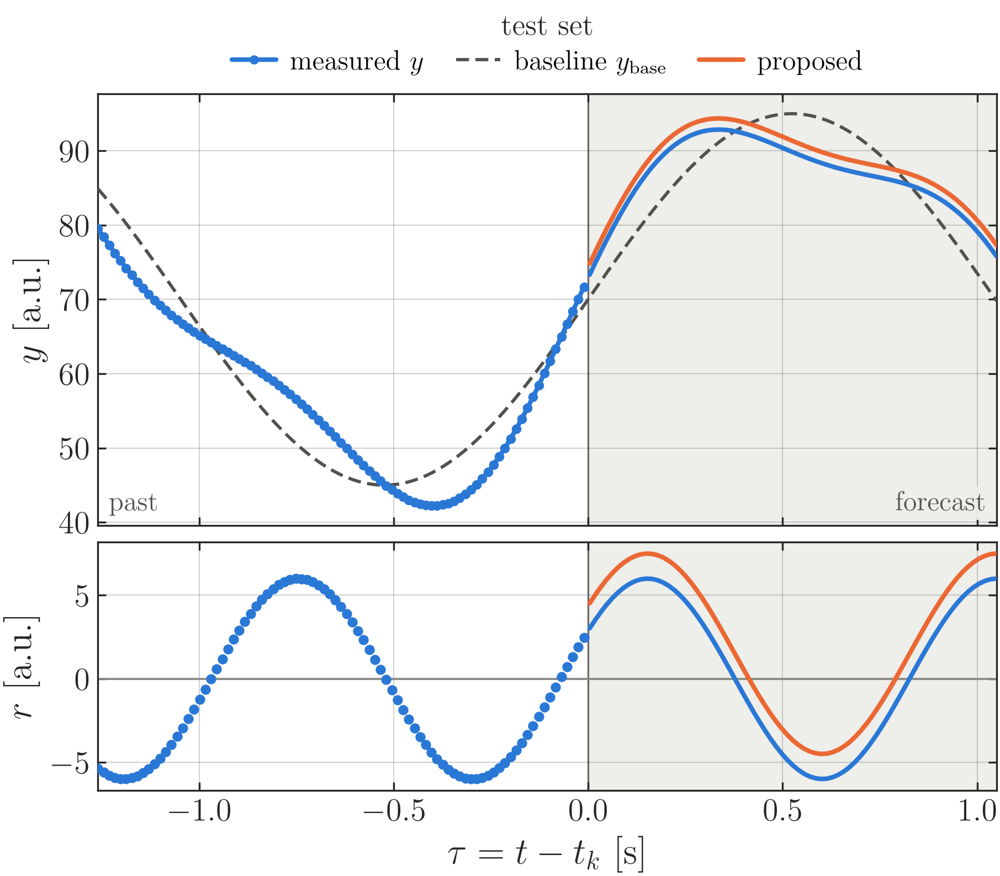
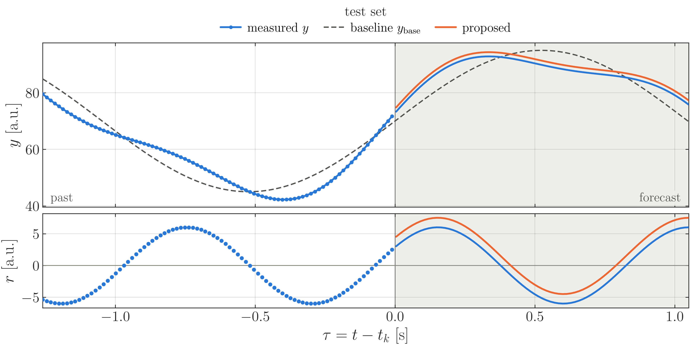

```python
def fig_example_snapshot(name):
    """Two stacked panels on one time axis: signal on top, residual below."""
    tau = np.linspace(-1.26, 1.05, 160)                      # time from now [s]
    y_base = 70 + 25 * np.sin(3.0 * tau)                      # baseline model [a.u.]
    r = 6 * np.sin(7.0 * tau + 0.5)                          # residual [a.u.]
    y = y_base + r                                            # measured signal [a.u.]
    past, fut = tau <= 0, tau >= 0
    fig, (axy, axr) = stacked(height("snapshot"), [2.0, 1.15])
    for ax in (axy, axr):
        ax.axvspan(0, tau[-1], color=NEUTRAL, alpha=0.28, lw=0, zorder=0)    # forecast region
        ax.axvline(0, color=C_AX, lw=0.8, alpha=0.6, zorder=1)               # now
    axy.plot(tau[past], y[past], color=C_MEAS, lw=2.0, marker="o", ms=3.2, zorder=4)
    axy.plot(tau[fut], y[fut], color=C_MEAS, lw=2.0, zorder=4)
    axy.plot(tau, y_base, color=C_BASE, lw=1.4, ls=LS_BASE, zorder=3)
    axy.plot(tau[fut], y[fut] + 1.5, color=C_PROPOSED, lw=2.0, zorder=6)
    axr.axhline(0, color=MUTED, lw=0.9, zorder=1)
    axr.plot(tau[past], r[past], color=C_MEAS, lw=0, marker="o", ms=3.4, zorder=4)
    axr.plot(tau[fut], r[fut], color=C_MEAS, lw=2.0, zorder=4)
    axr.plot(tau[fut], r[fut] + 1.5, color=C_PROPOSED, lw=2.0, zorder=6)
    axy.set_xlim(tau[0], tau[-1])
    axy.set_ylabel(r"$y$ [a.u.]")
    axr.set_ylabel(r"$r$ [a.u.]")
    axr.set_xlabel(r"$\tau = t - t_k$ [s]")
    handles = [Line2D([], [], color=C_MEAS, lw=2.0, marker="o", ms=3, label=r"measured $y$"),
               Line2D([], [], color=C_BASE, lw=1.4, ls=LS_BASE, label=LAB_BASE),
               Line2D([], [], color=C_PROPOSED, lw=2.0, label=LAB_PROPOSED)]
    legend_top(axy, handles, ncol=3, title=TAG_TEST)
    # in-panel tags on a patch of the local background, so no curve runs through them
    for x, s, ha, fc in ((0.012, "past", "left", "white"), (0.988, "forecast", "right", "#eeeeeb")):
        axy.text(x, 0.035, s, transform=axy.transAxes, ha=ha, fontsize=LEGEND_FS, color=INK_2,
                 zorder=10, bbox=dict(boxstyle="square,pad=0.15", fc=fc, ec="none", alpha=0.9))
    finish(fig, [axy, axr])
    save(fig, name)
```

### 6.2 A metric with its distribution: transparency ramp

Recipe `fig_example_bands`. The line is the metric of the whole data set (here the RMSE
of the test set versus the horizon); the shading is the distribution of the same metric over the
pieces of the data set (here the RMSE of each of the 246 cycles), so the line runs inside its own
shading. The ramp is built from `n_bands = 40` nested percentile bands of the same colour, each
with opacity `alpha_max / n_bands`: they add up to an opacity `alpha_max * (1 - t^gamma)` at
quantile distance `t` from the median, i.e. opaque in the middle, transparent at the tails, with
no visible edges. Filled patches (`fill_between`), not an image: the surface is connected along x,
stays vector in the PDF and has no column seams. The three models are drawn in one panel; where
two ramps overlap the colours mix, which is acceptable here because the distributions are nested.
Cut the x axis on the data (`ax.set_xlim(x[0], x[-1])`), otherwise the shading stops before the
frame.

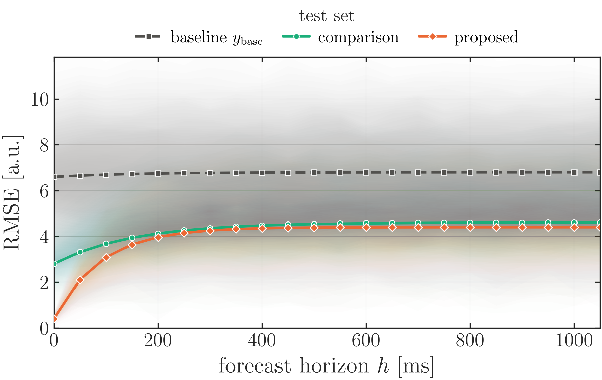
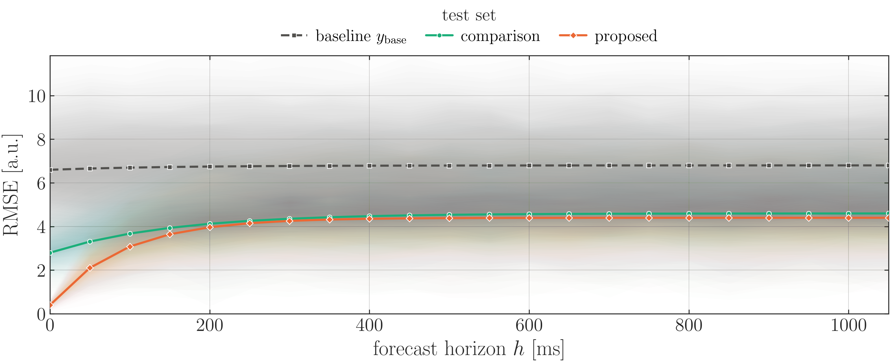

```python
def fig_example_bands(name):
    """A metric versus a parameter, with the distribution of that metric over the pieces of the
    data set as a transparency ramp: one connected surface per model (nested filled bands,
    opaque at the median piece, fading towards the extreme ones), the metric of the whole data
    set on top. The shaded distribution and the line must be the same quantity, otherwise the
    line does not run inside its shading."""
    h = np.arange(0, 1051, 50)                               # forecast horizon [ms]
    rng = np.random.default_rng(0)
    rows = [(C_BASE, LS_BASE, "s", LAB_BASE, 6.6 + 0.2 * (1 - np.exp(-h / 150))),
            (C_COMPARE, "-", "o", LAB_COMPARE, 2.8 + 1.8 * (1 - np.exp(-h / 150))),
            (C_PROPOSED, "-", "D", LAB_PROPOSED, 0.4 + 4.0 * (1 - np.exp(-h / 90)))]
    fig, (ax,) = stacked(height("curve"), [1.0])
    y_max = 0.0
    for c, ls, mk, lab, rmse in rows:
        # per-piece values: here 250 "cycles", each with its own level and noise
        per_piece = rmse * (1.0 + 0.35 * rng.standard_normal((250, 1))
                            + 0.10 * rng.standard_normal((250, h.size)))
        Q = np.percentile(np.maximum(per_piece, 0.0), RAMP_Q, axis=0)
        ramp_bands(ax, h, Q, color=c)                        # the distribution, as patches
        y_max = max(y_max, Q[int(np.argmin(np.abs(RAMP_Q - 97.0)))].max())
    for c, ls, mk, lab, rmse in rows:
        ax.plot(h, rmse, color=c, ls=ls, marker=mk, ms=4.0, lw=1.8, mec="white", mew=0.6,
                zorder=4, label=lab)
    ax.set_xlim(h[0], h[-1])                                 # cut on the data: no white margin
    ax.set_ylim(0, 1.02 * y_max)
    ax.set_xlabel(r"forecast horizon $h$ [ms]")
    ax.set_ylabel(r"RMSE [a.u.]")
    legend_top(ax, ncol=3, title=TAG_TEST)
    finish(fig, [ax])
    save(fig, name)
```

### 6.3 Two windows of a signal side by side

Recipe `fig_example_split`: two windows of the same signal as two columns of closed tiles.
The column widths are proportional to the window lengths (same seconds per inch), the y axes are
shared along each row (tick labels only on the left), and the gap `wspace = 0.1` separates the
tiles. A broken axis (hidden inner spines and break marks) was tried and dropped: separate tiles
read more clearly.

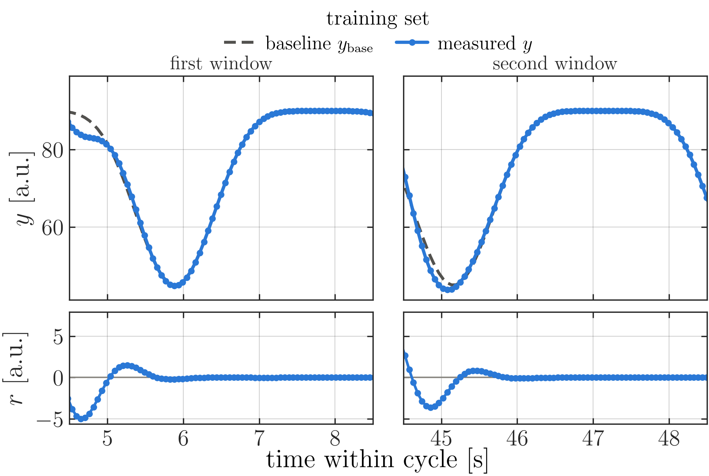
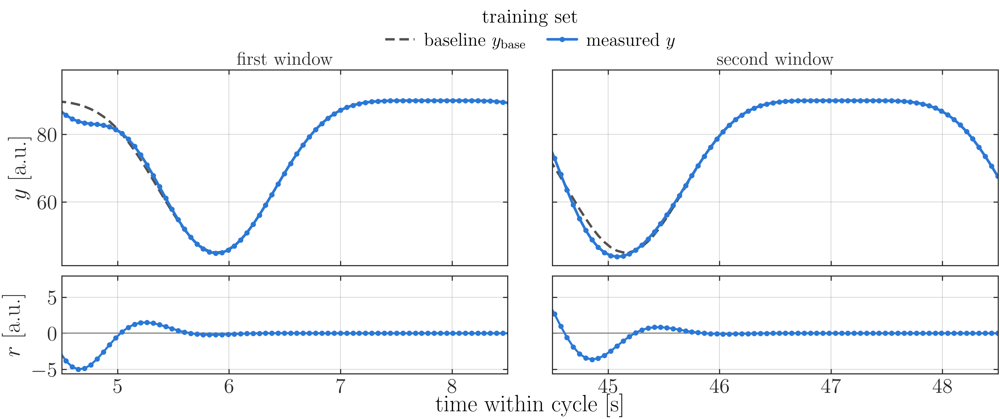

```python
def fig_example_split(name):
    """Two windows of the same signal as two columns of closed tiles (same seconds per inch)."""
    t = np.arange(0, 50, 0.056)                              # time within the cycle [s]
    y_base = 90 - 45 * np.abs(np.sin(0.8 * t)) ** 6
    y = y_base + 8 * np.sin(5 * t) * np.exp(-((t % 8) - 4) ** 2)
    windows = [(4.5, 8.5, "first window"), (44.5, 48.5, "second window")]
    ratios = [1.4, 0.7]                                      # signal, residual
    fig = plt.figure(figsize=(FIG_W, height("split")))
    gs = fig.add_gridspec(len(ratios), len(windows), height_ratios=ratios, hspace=0.07,
                          wspace=0.1, width_ratios=[b - a for a, b, _ in windows])
    axes = [[None] * len(windows) for _ in ratios]
    for i in range(len(ratios)):
        for j in range(len(windows)):
            axes[i][j] = fig.add_subplot(gs[i, j], sharex=axes[0][j] if i else None,
                                         sharey=axes[i][0] if j else None)
    for j, (a, b, title) in enumerate(windows):
        axy, axr = axes[0][j], axes[1][j]
        m = (t >= a - 0.3) & (t <= b + 0.3)
        axy.plot(t[m], y_base[m], color=C_BASE, lw=1.8, ls=LS_BASE, label=LAB_BASE)
        axy.plot(t[m], y[m], color=C_MEAS, lw=2.0, marker="o", ms=3, label=r"measured $y$")
        axr.axhline(0, color=MUTED, lw=0.9)
        axr.plot(t[m], y[m] - y_base[m], color=C_MEAS, lw=1.6, marker="o", ms=3)
        axy.set_xlim(a, b)
        axy.set_title(title, fontsize=LEGEND_FS, color=C_AX, pad=4)
        axy.tick_params(labelbottom=False)
        if j:                                                # shared y: labels on the left only
            axy.tick_params(labelleft=False)
            axr.tick_params(labelleft=False)
    axes[0][0].set_ylabel(r"$y$ [a.u.]")
    axes[1][0].set_ylabel(r"$r$ [a.u.]")
    fig.supxlabel(r"time within cycle [s]", fontsize=LABEL_FS, y=0.0)
    h, l = axes[0][0].get_legend_handles_labels()
    fig.legend(h, l, loc="lower center", bbox_to_anchor=(0.5, 0.9), ncol=2, frameon=False,
               fontsize=LEGEND_FS, title=TAG_TRAIN, title_fontsize=LEGEND_FS + 1)
    finish(fig, [ax for row in axes for ax in row])
    save(fig, name)
```

### 6.4 Curves with a zoom, and grouped bars

Recipe `fig_example_convergence`. When curves coincide at full scale, zoom on the converged part
instead of adding a panel: `zoom_plot(ax, xlim=..., ylim=..., position=[l, b, w, h])` makes the
inset, copies the curves into it, and marks the region with a rectangle and two connectors, so the
reader sees which part is magnified (a bare `inset_axes` does not). Legends shared by a row of
panels go into `fig.legend` above the row. Bars start at zero; `1.18 * max` leaves room above them.

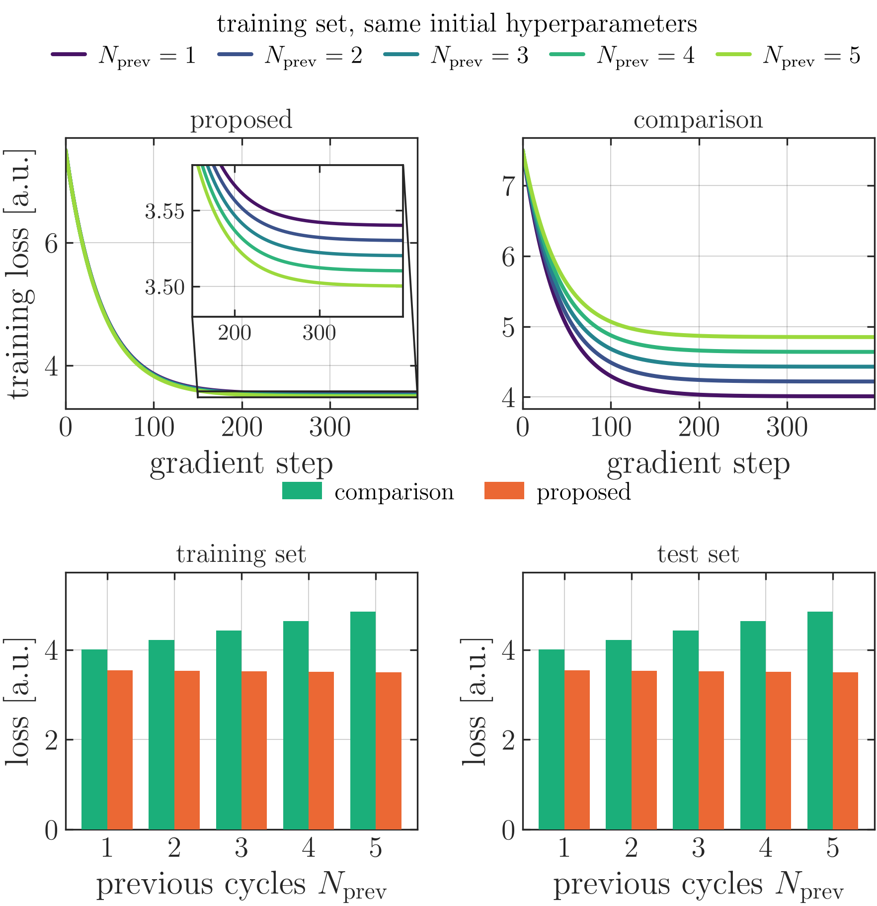
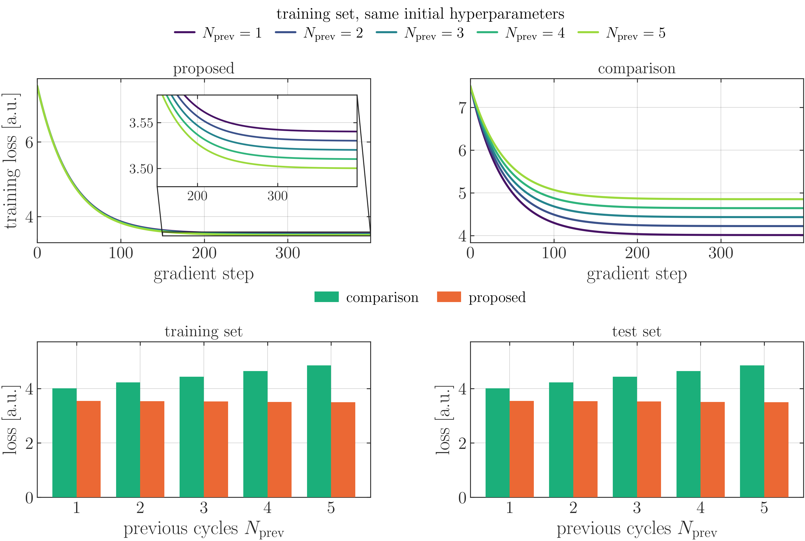

```python
def fig_example_convergence(name):
    """Top: loss curves of an ordered series, with an inset on the converged part.
    Bottom: grouped bars of one number per order and model."""
    ns = [1, 2, 3, 4, 5]
    cols = viridis_colours(ns)
    steps = np.arange(400)
    final = {LAB_PROPOSED: {n: 3.55 - 0.01 * n for n in ns}, LAB_COMPARE: {n: 3.8 + 0.21 * n for n in ns}}
    fig = plt.figure(figsize=(FIG_W, height("grid")))
    gs = fig.add_gridspec(2, 2, height_ratios=[1.0, 0.95], hspace=0.62, wspace=0.3)
    axc = [fig.add_subplot(gs[0, 0]), fig.add_subplot(gs[0, 1])]
    axb = [fig.add_subplot(gs[1, 0]), fig.add_subplot(gs[1, 1])]
    for ax, lab in zip(axc, (LAB_PROPOSED, LAB_COMPARE)):
        for n in ns:
            loss = final[lab][n] + (7.5 - final[lab][n]) * np.exp(-steps / 40)
            ax.plot(steps, loss, color=cols[n], lw=1.9, label=rf"$N_{{\mathrm{{prev}}}} = {n}$")
        ax.set_title(lab, fontsize=LEGEND_FS + 1, color=C_AX, pad=5)
        ax.set_xlabel(r"gradient step")
        ax.set_xlim(0, steps[-1])
    # the curves coincide at full scale: zoom on the converged part. zoom_plot copies the curves
    # into the inset and marks the zoomed region on the parent axes (rectangle + two connectors)
    fin = list(final[LAB_PROPOSED].values())
    zm = zoom_plot(axc[0], xlim=(150, steps[-1]), ylim=(min(fin) - 0.02, max(fin) + 0.04),
                   position=(0.36, 0.34, 0.6, 0.56), color=C_AX, lw=0.9, tick_fs=TICK_FS - 3)
    for ln in zm.child.lines:
        ln.set_linewidth(1.6)
    axc[0].set_ylabel(r"training loss [a.u.]")
    up = 0.34 / fig.get_figheight()               # 0.34 in above a panel: clear of its title
    h, l = axc[0].get_legend_handles_labels()
    fig.legend(h, l, loc="lower center", bbox_to_anchor=(0.5, axc[0].get_position().y1 + up),
               ncol=5, frameon=False, fontsize=LEGEND_FS, columnspacing=0.9, handlelength=1.3,
               title="training set, same initial hyperparameters", title_fontsize=LEGEND_FS + 1)
    x, w = np.arange(len(ns)), 0.38
    for ax, tag in zip(axb, (TAG_TRAIN, TAG_TEST)):
        comp = np.array([final[LAB_COMPARE][n] for n in ns])
        prop = np.array([final[LAB_PROPOSED][n] for n in ns])
        ax.bar(x - w / 2, comp, w, color=C_COMPARE, label=LAB_COMPARE, zorder=3)
        ax.bar(x + w / 2, prop, w, color=C_PROPOSED, label=LAB_PROPOSED, zorder=3)
        ax.set_xticks(x, [str(n) for n in ns])
        ax.tick_params(axis="x", which="minor", bottom=False, top=False)
        ax.set_xlabel(r"previous cycles $N_{\mathrm{prev}}$")
        ax.set_ylabel(r"loss [a.u.]")
        ax.set_ylim(0, 1.18 * max(comp.max(), prop.max()))  # bars start at zero
        ax.set_title(tag, fontsize=LEGEND_FS + 1, color=C_AX, pad=5)
    h, l = axb[0].get_legend_handles_labels()
    fig.legend(h, l, loc="lower center", bbox_to_anchor=(0.5, axb[0].get_position().y1 + up),
               ncol=2, frameon=False, fontsize=LEGEND_FS)
    finish(fig, axc + axb)
    save(fig, name)
```

### 6.5 Path coloured by a value

Recipe `fig_example_map`: a `LineCollection` coloured by the value, equal aspect, panel height
from the data aspect, horizontal colour bar in its own grid row. The colour scale is capped at the
98th percentile (`extend="max"`) so a few peaks do not wash out the rest. For two maps with the same
scale, use one `Normalize` for both and one colour bar.

The rectangles mark the pieces of path that other figures show in the time domain (first solid,
the following ones dashed), and `save_labels` writes their labels into
`images/paper/<name>_labels.tex`; the document puts `Fig.~\ref{...}` there with `\ovlfig`
(section 8), so the numbers stay right when the figure order changes. The anchor (`south`,
`north`, `west`, `east`) says on which side of the box the label sits, in screen sense — with an
inverted y axis (image-style coordinates) `south` is still above the box.

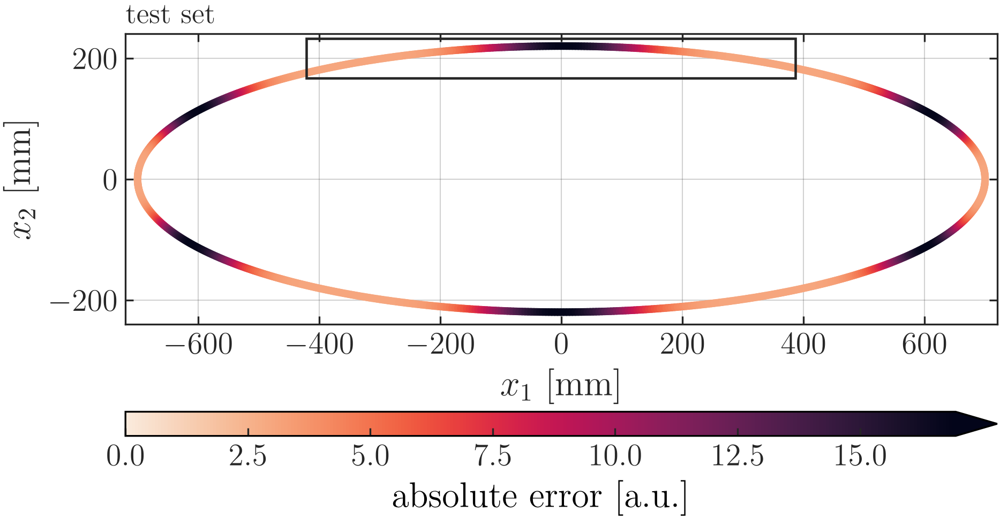
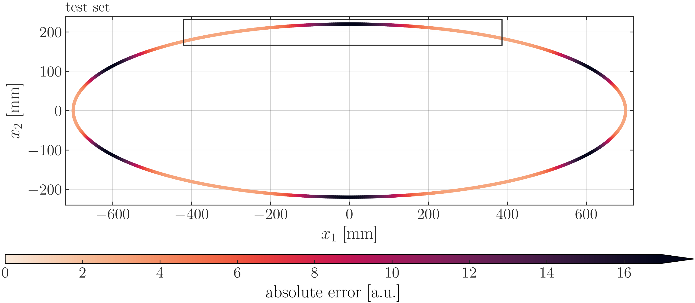

```python
def fig_example_map(name, boxes=((1.0, 2.2, "fig:window", "north"),)):
    """A path in the plane, coloured by a value, with a colour bar. `boxes` are
    windows of the path (here in the parameter s) marked by a rectangle; their labels are
    written by LaTeX from <name>_labels.tex, so they follow the numbering of the document."""
    import seaborn as sns
    from matplotlib.collections import LineCollection
    from matplotlib.colors import Normalize
    s = np.linspace(0, 2 * np.pi, 900)
    X, Y = 700 * np.cos(s), 220 * np.sin(s)                  # path of one cycle [mm]
    err = 3 + 14 * np.abs(np.sin(3 * s)) ** 6                # value along the path [a.u.]
    pts = np.column_stack([X, Y])
    segs = np.stack([pts[:-1], pts[1:]], axis=1)
    cmap = sns.color_palette("rocket_r", as_cmap=True)
    norm = Normalize(0, float(np.percentile(err, 98)))       # cap at p98: colour bar "extend"
    panel_h = (FIG_W - 1.0) * (np.ptp(Y) + 40) / (np.ptp(X) + 40)   # height from the data aspect
    fig = plt.figure(figsize=(FIG_W, panel_h + 1.3))         # FIG_W - 1 in: the width of the panel
    gs = fig.add_gridspec(2, 1, height_ratios=[panel_h, 0.16], hspace=0.5)
    ax, cax = fig.add_subplot(gs[0]), fig.add_subplot(gs[1])
    lc = LineCollection(segs, cmap=cmap, norm=norm, linewidth=3.4, capstyle="round")
    lc.set_array(0.5 * (err[:-1] + err[1:]))
    ax.add_collection(lc)
    ax.set_aspect("equal", adjustable="box")
    ax.set_xlim(X.min() - 20, X.max() + 20)
    ax.set_ylim(Y.min() - 20, Y.max() + 20)
    ax.set_xlabel(r"$x_1$ [mm]")
    ax.set_ylabel(r"$x_2$ [mm]")
    ax.set_title(TAG_TEST, loc="left", fontsize=LEGEND_FS + 1, color=C_AX, pad=5)
    cb = fig.colorbar(plt.cm.ScalarMappable(norm=norm, cmap=cmap), cax=cax,
                      orientation="horizontal", extend="max")
    cb.set_label(r"absolute error [a.u.]", fontsize=LABEL_FS)
    cb.ax.tick_params(labelsize=TICK_FS, direction="in", colors=C_AX)
    tags, pad = [], 12.0                                     # [mm] around the marked path
    for j, (s_a, s_b, ref, anchor) in enumerate(boxes):
        m = (s >= s_a) & (s <= s_b)
        x0, x1 = X[m].min() - pad, X[m].max() + pad
        y0, y1 = Y[m].min() - pad, Y[m].max() + pad
        ax.add_patch(Rectangle((x0, y0), x1 - x0, y1 - y0, fill=False, edgecolor=C_AX, lw=1.1,
                               ls="-" if j == 0 else (0, (4, 2)), zorder=6))
        off = 6.0                                            # label clear of the box
        y_top, y_bot = (y0, y1) if ax.yaxis_inverted() else (y1, y0)
        up, down = (-off, off) if ax.yaxis_inverted() else (off, -off)
        cx, cy = 0.5 * (x0 + x1), 0.5 * (y0 + y1)
        pt = {"south": (cx, y_top + up), "north": (cx, y_bot + down),
              "west": (x1 + off, cy), "east": (x0 - off, cy)}[anchor]
        tags.append((ax, pt[0], pt[1], ref, anchor))
    finish(fig, [ax])
    save_labels(fig, name, tags)
    save(fig, name)
```

### 6.6 Top views of different objects with tiles of the same width

Recipe `fig_example_topviews`. With `set_aspect("equal")` the default `adjustable="box"` shrinks every
tile to the aspect of its data, so a long object gets a wide tile and a compact one a narrow tile.
Instead, give each tile the height ratio of its data (vertical span / horizontal span), compute
the figure height that makes the tiles exactly as wide as the grid, and use
`adjustable="datalim"`, which keeps the tile and adapts the limits.

The function draws at `w_rel * FIG_W` (0.6 here, rule 15); include it at
`0.6\linewidth`.

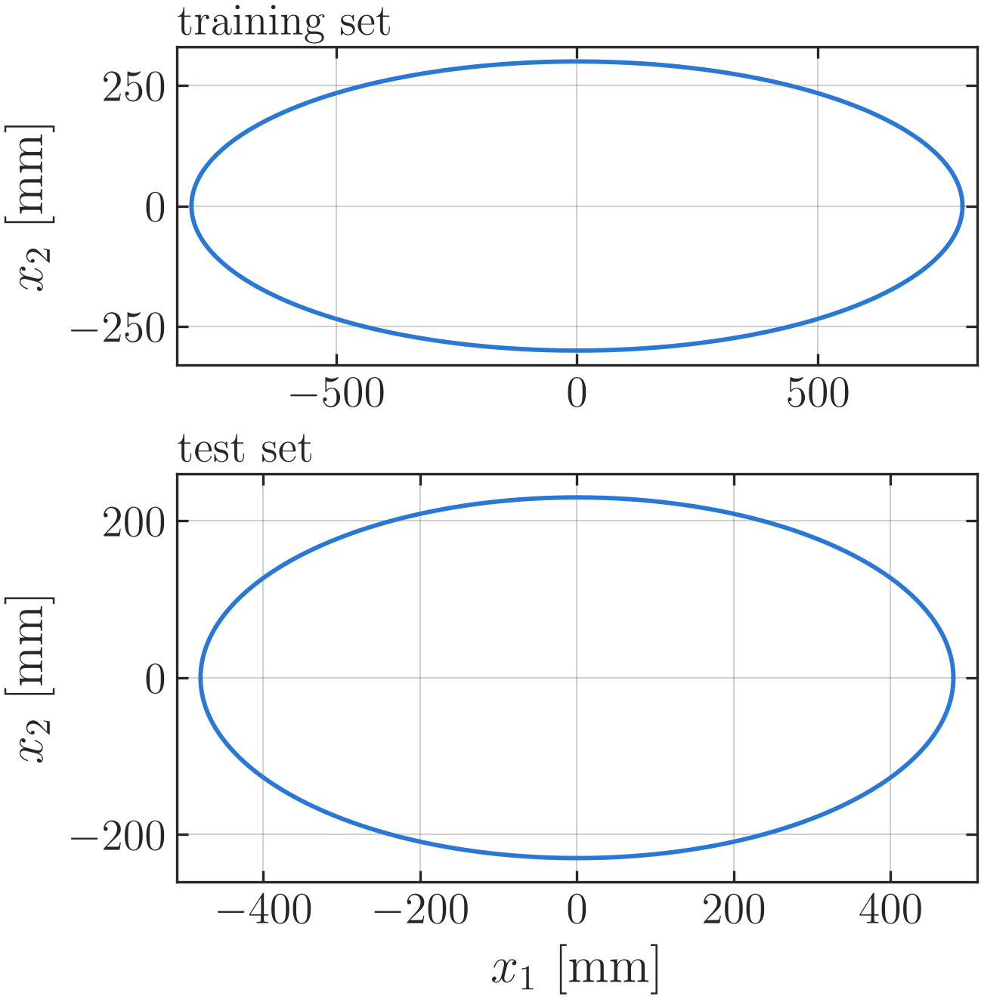
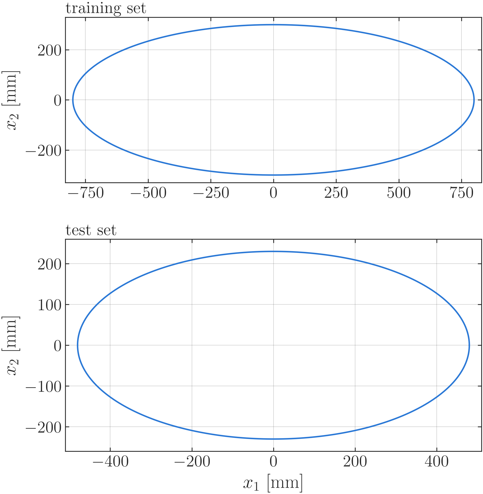

```python
def fig_example_topviews(name, w_rel=0.6):
    """Top views of two objects of different shape, equal axes, tiles of the same width. Drawn at
    w_rel * FIG_W and included at w_rel * \\linewidth (rule 15), 0.6 here."""
    s = np.linspace(0, 2 * np.pi, 600)
    shapes = [("training set", 800 * np.cos(s), 300 * np.sin(s)),
              ("test set", 480 * np.cos(s), 230 * np.sin(s))]
    pad = 30.0
    lims = [((X.min() - pad, X.max() + pad), (Y.min() - pad, Y.max() + pad)) for _, X, Y in shapes]
    ratios = [(lv[1] - lv[0]) / (lh[1] - lh[0]) for lh, lv in lims]   # height / width of the data
    hspace, left, right, bottom, top = 0.3, 0.14, 0.98, 0.1, 0.94
    W = w_rel * FIG_W
    fig_h = W * (right - left) * (sum(ratios) + hspace * np.mean(ratios)) / (top - bottom)
    fig = plt.figure(figsize=(W, fig_h))
    gs = fig.add_gridspec(len(shapes), 1, height_ratios=ratios, hspace=hspace, left=left,
                          right=right, bottom=bottom, top=top)
    axes = [fig.add_subplot(gs[i]) for i in range(len(shapes))]
    for ax, (tag, X, Y), (lh, lv) in zip(axes, shapes, lims):
        ax.plot(X, Y, color=BLUE, lw=1.4)
        ax.set_xlim(*lh)
        ax.set_ylim(*lv)
        ax.set_aspect("equal", adjustable="datalim")         # keep the tile width, adapt limits
        ax.set_ylabel(r"$x_2$ [mm]")
        ax.set_title(tag, loc="left", fontsize=LEGEND_FS + 2, color=C_AX, pad=4)
    axes[-1].set_xlabel(r"$x_1$ [mm]")
    fig.align_ylabels(axes)
    finish(fig, axes)
    save(fig, name)
```

### 6.7 A row of tiles at full width

Recipe `fig_example_tiles`, the typical full-width figure of a single-column paper
(rule 18): one tile per model, the same y axis (labels on the first tile only), the distribution of
the metric as a transparency ramp inside each tile, so no two fans overlap (trap: overlaid
transparent fans turn muddy). Three tiles are the most a 5.5 in text width holds (rule 20); each
is about 1.35 in wide when printed. The data set is named by an in-panel tag on a patch of the
background colour; the model names are the tile titles. Ticks stay away from the right limit
(0, 400, 800 on a 0-1050 ms axis), otherwise the "1000" of one tile touches the "0" of the next.

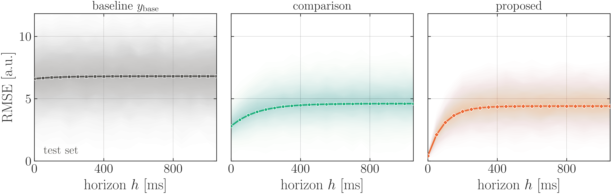

```python
def fig_example_tiles(name):
    """One tile per model, shared y axis, the distribution of the metric over the pieces of the
    data set as a transparency ramp, the metric of the whole data set on top."""
    h = np.arange(0, 1051, 50)                               # forecast horizon [ms]
    rng = np.random.default_rng(0)
    rows = [(C_BASE, "s", LAB_BASE, 6.6 + 0.2 * (1 - np.exp(-h / 150))),
            (C_COMPARE, "o", LAB_COMPARE, 2.8 + 1.8 * (1 - np.exp(-h / 150))),
            (C_PROPOSED, "D", LAB_PROPOSED, 0.4 + 4.0 * (1 - np.exp(-h / 90)))]
    fig = plt.figure(figsize=(FIG_W, height("tiles")))
    gs = fig.add_gridspec(1, len(rows), wspace=0.08)
    axes, y_max = [], 0.0
    for j, (c, mk, lab, rmse) in enumerate(rows):
        ax = fig.add_subplot(gs[j], sharey=axes[0] if j else None)
        per_piece = rmse * (1.0 + 0.35 * rng.standard_normal((250, 1))
                            + 0.10 * rng.standard_normal((250, h.size)))
        Q = np.percentile(np.maximum(per_piece, 0.0), RAMP_Q, axis=0)
        ramp_bands(ax, h, Q, color=c)
        ax.plot(h, rmse, color=c, marker=mk, ms=4.0, lw=1.8, mec="white", mew=0.6, zorder=4)
        y_max = max(y_max, Q[int(np.argmin(np.abs(RAMP_Q - 97.0)))].max())
        ax.set_xlim(h[0], h[-1])
        ax.set_xticks([0, 400, 800])                         # no tick at the right limit
        ax.set_xlabel(r"horizon $h$ [ms]")
        ax.set_title(lab, fontsize=LEGEND_FS + 1, color=C_AX, pad=5)
        if j:
            ax.tick_params(labelleft=False)                  # shared y: labels on the left only
        axes.append(ax)
    axes[0].set_ylim(0, 1.02 * y_max)
    axes[0].set_yticks([0, 5, 10])                           # short labels: "0.0" would touch the x "0"
    axes[0].set_ylabel(r"RMSE [a.u.]")
    axes[0].text(0.05, 0.05, TAG_TEST, transform=axes[0].transAxes, fontsize=LEGEND_FS, color=INK_2,
                 zorder=10, bbox=dict(boxstyle="square,pad=0.15", fc="white", ec="none", alpha=0.9))
    finish(fig, axes)
    save(fig, name)
```

### 6.8 Two figures side by side

Pattern of the half-width pair of a single-column paper (rule 18, 19): each figure is drawn at
`HALF * FIG_W` (5.28 in with `single`), set side by side with `\hfill` and `subcaption` (section 8).
So that the two frames line up at print size, both get the same height (`height("pair", HALF)`)
and the same build: one legend (title and one row) above the panel and one label line under it
(rule 19). At half width a legend holds two entries per row (`ncol=2`); a third goes into a second
row, in both figures. The picture shows the two saved files as `\hfill` places them.

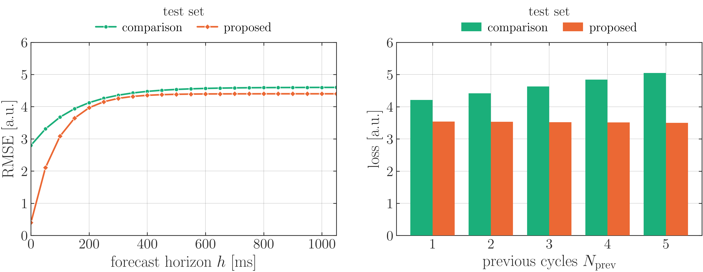

```python
def fig_example_pair(name):
    """Two figures that stand side by side (written as <name>_a and <name>_b), each HALF wide."""
    w, hh = HALF * FIG_W, height("pair", HALF)
    h = np.arange(0, 1051, 50)                               # forecast horizon [ms]
    ns = np.arange(1, 6)                                     # previous cycles
    # (a) a metric versus a parameter, two models
    fig, (ax,) = stacked(hh, [1.0], width=w)
    ax.plot(h, 2.8 + 1.8 * (1 - np.exp(-h / 150)), color=C_COMPARE, marker="o", ms=4.5, lw=1.8,
            mec="white", mew=0.6, label=LAB_COMPARE)
    ax.plot(h, 0.4 + 4.0 * (1 - np.exp(-h / 90)), color=C_PROPOSED, marker="D", ms=4.5, lw=1.8,
            mec="white", mew=0.6, label=LAB_PROPOSED)
    ax.set_xlim(h[0], h[-1])
    ax.set_ylim(0, 6)
    ax.set_xlabel(r"forecast horizon $h$ [ms]")
    ax.set_ylabel(r"RMSE [a.u.]")
    legend_top(ax, ncol=2, title=TAG_TEST)
    finish(fig, [ax])
    save(fig, f"{name}_a")
    # (b) the same frame: grouped bars per number of previous cycles
    fig, (ax,) = stacked(hh, [1.0], width=w)
    x, bw = np.arange(len(ns)), 0.38
    ax.bar(x - bw / 2, 4.0 + 0.21 * ns, bw, color=C_COMPARE, label=LAB_COMPARE, zorder=3)
    ax.bar(x + bw / 2, 3.55 - 0.01 * ns, bw, color=C_PROPOSED, label=LAB_PROPOSED, zorder=3)
    ax.set_xticks(x, [str(n) for n in ns])
    ax.tick_params(axis="x", which="minor", bottom=False, top=False)
    ax.set_ylim(0, 6)
    ax.set_xlabel(r"previous cycles $N_{\mathrm{prev}}$")
    ax.set_ylabel(r"loss [a.u.]")
    legend_top(ax, ncol=2, title=TAG_TEST)
    finish(fig, [ax])
    save(fig, f"{name}_b")
```

## 7. Text in figures

* **Model and signal names** are the same in every figure and in the text:
  `proposed`, `comparison`, `baseline $y_{\mathrm{base}}$`, `measured $y$`,
  `$u$ (commanded input)`, `cycle $k-1$`. Use the constants `LAB_*` of the style module, and change
  them once per project.
* **Data sets** are `training set` and `test set` (legend title or panel title); no dates, no
  internal folder names.
* **Axis labels**: symbol and unit, `$\tau = t - t_k$ [s]`, `$r$ [a.u.]`, `$\kappa$ [1/m]`,
  `previous cycles $N_{\mathrm{prev}}$`. Words in subscripts go into `\mathrm{}`.
* **LaTeX special characters** in labels must be escaped: `\%`, `\_`, `\&`, `\#`.
* **Titles** only for the columns of a grid or for a map (`ax.set_title(..., fontsize=LEGEND_FS + 1,
  color=C_AX, pad=5)`); no figure titles. The message of the figure goes into the caption.
* **Tags inside a panel** ("past", "forecast") sit on a patch of the local background colour
  (`bbox=dict(boxstyle="square,pad=0.15", fc=..., ec="none", alpha=0.9)`) so no curve runs through
  them.
* **Panel letters** of two figures side by side ((a), (b)) are written by `\subcaption`, not
  drawn into the graphic.

## 8. LaTeX

`\linewidth` is `\columnwidth` in a two-column paper and `\textwidth` in a single-column paper, and
inside a `subfigure` it is the width of that subfigure, so the same line is right everywhere:

```latex
\usepackage{graphicx}
\graphicspath{{../images/paper/}}        % {../images/paper_single/} for --layout single

\begin{figure}[t]
  \centering
  \includegraphics[width=\linewidth]{fig_example_snapshot.pdf}
  \caption{Forecast at one instant of the test set. Top: measured signal, baseline model and
  the forecast of the proposed model. Bottom: residual.}
  \label{fig:snapshot}
\end{figure}
```

A figure that should take less space keeps its own scale (rule 15); include it at the fraction
`save` prints for it, in practice the `s` it was drawn for:

```latex
\includegraphics[width=0.6\linewidth]{fig_example_topviews.pdf}     % drawn at 0.6 * FIG_W
```

*Single-column:* two figures side by side (recipe 6.8, rules 18 and 19), each drawn at
`HALF * FIG_W`, with `subcaption`; `[t]` aligns their tops:

```latex
\usepackage{subcaption}

\begin{figure}[t]
  \centering
  \begin{subfigure}[t]{0.48\linewidth}
    \includegraphics[width=\linewidth]{fig_example_pair_a.pdf}
    \caption{RMSE versus horizon.}\label{fig:pair-a}
  \end{subfigure}\hfill
  \begin{subfigure}[t]{0.48\linewidth}
    \includegraphics[width=\linewidth]{fig_example_pair_b.pdf}
    \caption{Loss versus previous cycles.}\label{fig:pair-b}
  \end{subfigure}
  \caption{Both on the test set.}\label{fig:pair}
\end{figure}
```

*Single-column:* a figure next to the text, drawn at the same `s` it is included at:

```latex
\usepackage{wrapfig}

\begin{wrapfigure}{r}{0.58\linewidth}
  \centering
  \includegraphics[width=0.58\linewidth]{fig_example_topviews.pdf}
  \caption{Top views of two objects.}
\end{wrapfigure}
```

Labels written by LaTeX on top of a figure (rule 17, recipe 6.5). `<name>_labels.tex` is written by
the plot script and holds one `\ovltag{x}{y}{anchor}{label}` per label, with `x` and `y` as a
fraction of the image. `\ovlfig` takes the width as an optional first argument (`\ovlfig[0.6]{...}`):

```latex
\usepackage{tikz}
\newcommand{\ovltag}[4]{\node[anchor=#3, inner sep=1.2pt, font=\scriptsize, fill=white,
  fill opacity=0.78, text opacity=1] at (#1,#2) {Fig.~\ref{#4}};}
\newcommand{\ovlfig}[3][1]{%
  \begin{tikzpicture}
    \node[anchor=south west,inner sep=0] (im) {\includegraphics[width=#1\linewidth]{#2.pdf}};
    \begin{scope}[x={(im.south east)},y={(im.north west)}]\input{#3}\end{scope}
  \end{tikzpicture}}

\begin{figure}[t]\centering
  \ovlfig{fig_example_map}{../images/paper/fig_example_map_labels}
  \caption{... The boxes mark the pieces of path shown by the figures named in them.}
  \label{fig:map}
\end{figure}
```

* Always include the PDF (vector); the SVG is for editing (e.g. Inkscape), the PNG for previews.
* Place figures with `[t]`; put `\FloatBarrier` (package `placeins`) before the bibliography so no
  figure floats past it.
* Judge figures at print size: `latex/figure_sheet_two.tex` (elsarticle `5p`) and
  `latex/figure_sheet_single.tex` (single column, 5.5 in) lay **every** figure out at
  `\linewidth`; compile with `pdflatex` (twice, for the references) after re-drawing. For a
  venue, put its style file in the sheet instead of the stand-in (the sheet says where). Keep
  every figure in the sheet, also the ones the paper does not use: it is the place where a
  figure is chosen.

## 9. Checklist and traps

* [ ] Looked at the figure in the compiled preview at print size: no legend over data, no clipped
      labels, tick labels readable, legend order = drawing importance.
* [ ] Colours, dashes and labels follow the role table; data set named.
* [ ] Numbers quoted in the text come from the terminal output of the same run.
* [ ] PDF, SVG and PNG (300 dpi) written to `images/paper/`; figure background transparent, panels
      white.
* [ ] Every zoom has its rectangle and connectors; every box that stands for another figure has its
      label file, and the document was compiled twice so the numbers in it are right.
* [ ] The layout of the figures is the layout of the paper (`--layout`, folder `images/paper/` or
      `images/paper_single/`), and each figure is included at the width `save` printed for it.
* [ ] Two figures side by side: same height, same legend rows, `subfigure[t]`, judged together
      at print size (rule 19).

Traps met while making the paper figures:

* **`style_ax` turns ticks on for all four sides.** Hide spines or ticks (colour bars, special
  layouts) after calling it.
* **`savefig(transparent=True)` also makes the panels transparent.** For a transparent figure with
  white panels set `fig.patch.set_alpha(0)` and `ax.patch.set_facecolor("white")` before saving
  (done in `save`).
* **Overlaid transparent fans of several colours turn muddy**; put each distribution in its own tile
  with a shared y axis.
* **Tick labels at the edge of side-by-side tiles collide** ("1000" of one tile touches "0" of the
  next); place the ticks away from the right limit (0, 400, 800 on a 0-1050 ms axis).
* **Equal-aspect tiles of different shapes get different widths** with the default
  `adjustable="box"`; use height ratios from the data and `adjustable="datalim"` (recipe 6.6).
* **A very flat figure** (`0.2 * FIG_W`): shorten the y label (a rotated label longer than the
  panel sticks out), limit the y ticks (`MaxNLocator(nbins=3)`), put the legend in one row and name
  the data set inside the panel.
* **Shared axes share their tick locators.** Changing the minor ticks of one panel of a `sharex`
  stack changes all of them; to hide ticks on one panel use `tick_params(length=0)`.
* **Axis limits of a window** come from the data inside that window, with a 9 % pad; limits from
  the whole signal flatten the part that is shown.
* **The 5th percentile of an absolute error is close to 0**, so a fan of $|e|$ starts near zero and
  its darkest part (the median) sits well below the RMSE: the shading then does not follow the
  line drawn on top of it. Shade the distribution of the same quantity as the line (the metric per
  cycle / per window), or draw the median of what is shaded.
* **A shading drawn as an image** (`imshow`, `pcolormesh`) is rasterised in the PDF, and
  `pcolormesh` leaves faint vertical seams between its columns; nested `fill_between` bands
  (`ramp_bands`) look the same, stay vector and are connected along x.
* **Leave no white margin under a shading**: with the default `xlim` the ramp stops before the
  frame; set the limits to the first and last x of the data.
* **An inset without the rectangle** does not say what it magnifies; use `zoom_plot` and check that
  the rectangle is visible (a very flat region becomes a thin sliver, which is still the honest
  picture).
* **Label positions written for LaTeX are tied to the saved image**: re-run the plot script
  whenever the figure changes, otherwise the `Fig. n` tags sit next to the wrong box. They are
  computed from the tight bounding box and `pad_inches`, so changing either moves them.
* **A shrunk figure** (rule 15) must be included at the matching `s\columnwidth`; at
  `\columnwidth` its text prints `1/s` times too large.
* **`usetex` needs LaTeX** (MiKTeX / TeX Live) on the `PATH`; the first run is slow while the font
  cache is built. A label with an unescaped `%` or `_` stops the save with a LaTeX error. Without
  LaTeX the module draws with matplotlib's own maths font (it says so at the start): fine for a
  draft, not for the final figures.
* **Colour maps only with a colour bar**; unexplained colours read as noise. Linear axes by default,
  logarithmic only when the data span decades.
* **Windows console** (cp1252): keep terminal prints ASCII (`->`, `...`) or run `python -X utf8`.
* **Very long paths** (more than 260 characters, e.g. deep OneDrive or temp folders) make `savefig`
  fail with `FileNotFoundError` although the folder exists; write to a shorter path.
* **With `torch` in the same script**, import `numpy` and `pandas` before `torch` (otherwise
  "OMP: Error #15" on Windows / conda).
* **The printed text size is nominal.** `save` prints "saved X in = Y \linewidth": the text prints
  at drawn size x (printed width / saved width), and the saved width is smaller than `FIG_W`
  because tight cropping removes the unused margin of matplotlib's default panel margins (0.125 /
  0.9 of the width). With `two` the recipes save 6.0 of 7.0 in, a scale of 0.58, so 16 / 14 / 12 pt
  print at about 9.3 / 8.1 / 7.0 pt, not at 8 / 7 / 6. With `single` the side margins are 0.05
  (`LAYOUTS`), the saved width is about 10.5 of 11 in, a scale of 0.52, and 18 / 16 / 14 pt print at
  about 9.4 / 8.4 / 7.3 pt. To get other printed sizes change `fonts` (or `side`) in the `LAYOUTS`
  line of the layout; do not scale the included graphic by hand.
* **A figure of a pair that has a legend or a label the other has not** is cropped to a different
  height, and the two frames no longer line up next to each other (rule 19). Give both the same
  elements, or none.

## 10. Single-column papers (NeurIPS, ICLR)

A single-column paper uses the same style (sections 1 to 9) at a different size. What is different:

* **Width and text.** The text width is 5.5 in (check the style file of the year with the
  `\typeout` line of section 2). A full figure is drawn 11 in wide with `--layout single`, fonts
  18 / 16 / 14 pt, and prints with text of about 9 / 8 / 7 pt next to the 10 pt body. 7 pt is the
  smallest text of the paper; if a figure needs more room make it wider or split it, do not shrink
  the fonts (rule 15).
* **One panel is half width, a full figure is a row** (rules 18 to 20). 5.5 in is too wide for one
  curve and too narrow for more than three tiles.
* **Figures cost pages.** The main text of a NeurIPS paper has a page limit (9 pages in recent
  calls; check the current one) and a figure counts against it like text. Printed heights from the
  table in section 2: a row of tiles 1.65 in, a signal with its residual 2.6 in, a 2 x 2 grid 3.5 in,
  on a text height of 9 in.
* **Colour.** The palette is assigned by role, and the baseline is also dashed and the models have
  different markers, so a figure stays readable in a grey-scale print.

How each recipe is used in a single-column paper:

| recipe | in a single-column paper |
|---|---|
| 6.1 signal and residual | full width, as it is |
| 6.2 metric with its distribution | one panel is too wide at full width: use 6.7, or draw it at `HALF` (6.8) |
| 6.3 two windows of a signal | full width, as it is (the layout this width is good for) |
| 6.4 curves with a zoom, grouped bars | full width, 3.5 in tall; or split it into two figures of 6.8 |
| 6.5 path coloured by a value | full width for an elongated object, `0.6` for a compact one |
| 6.6 top views | `w_rel = 0.6`, or beside the text with `wrapfigure` (section 8) |
| 6.7 a row of tiles | the standard full-width figure |
| 6.8 two figures side by side | the standard one-panel figure |

Setting up a new single-column paper:

1. Copy `paper_style.py` and `zoom_plot.py` next to the figure scripts; run every script with
   `--layout single` (or `set PAPER_LAYOUT=single`).
2. Point `\graphicspath` at `images/paper_single/`; include figures at `\linewidth` and
   `s\linewidth` (section 8).
3. Put every figure on one candidates sheet in the venue's class and judge it at print size
   (section 8), before the paper text is written around it.
4. For another class, add a line to `LAYOUTS` with its `\linewidth`, the font sizes and `side`
   (section 4), and an entry to `ASPECT` if its heights should differ.
