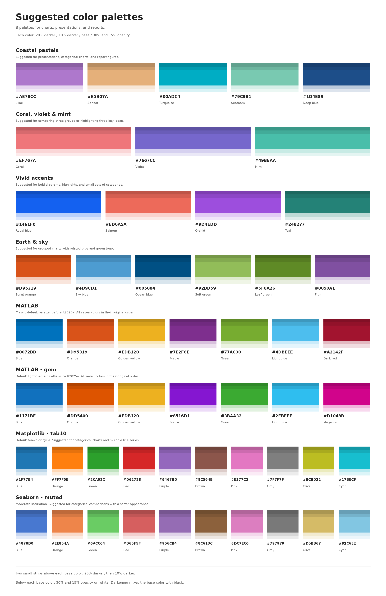

# Suggested color palettes

8 palettes for charts, presentations, and reports.

[Open the palette image (SVG)](images/paper_color_palette.svg) | [PNG version](images/paper_color_palette.png)

Two small strips above each base color show 20% darker at the top, then 10% darker.
The dark strips match the size of the light strips below. Their HEX codes are listed in the tables.
Darkening mixes the base color with black: `darker = base * (1 - amount)`, rounded to 8-bit RGB.
Below each base color, the two strips show 30% and 15% opacity on white.
Use solid colors for lines and markers, and lighter fills for bands or shaded areas.

## Coastal pastels

Suggested for presentations, categorical charts, and report figures.

| Order | Color | Base HEX | 10% darker | 20% darker | Base RGB (0-255) | Base RGB (0-1) |
|---|---|---|---|---|---|---|
| 1 | Lilac | `#AE78CC` | `#9D6CB8` | `#8B60A3` | 174 120 204 | 0.682353 0.470588 0.800000 |
| 2 | Apricot | `#E5B07A` | `#CE9E6E` | `#B78D62` | 229 176 122 | 0.898039 0.690196 0.478431 |
| 3 | Turquoise | `#00ADC4` | `#009CB0` | `#008A9D` | 0 173 196 | 0.000000 0.678431 0.768627 |
| 4 | Seafoam | `#79C9B1` | `#6DB59F` | `#61A18E` | 121 201 177 | 0.474510 0.788235 0.694118 |
| 5 | Deep blue | `#1D4E89` | `#1A467B` | `#173E6E` | 29 78 137 | 0.113725 0.305882 0.537255 |

## Coral, violet & mint

Suggested for comparing three groups or highlighting three key ideas.

| Order | Color | Base HEX | 10% darker | 20% darker | Base RGB (0-255) | Base RGB (0-1) |
|---|---|---|---|---|---|---|
| 1 | Coral | `#EF767A` | `#D76A6E` | `#BF5E62` | 239 118 122 | 0.937255 0.462745 0.478431 |
| 2 | Violet | `#7667CC` | `#6A5DB8` | `#5E52A3` | 118 103 204 | 0.462745 0.403922 0.800000 |
| 3 | Mint | `#49BEAA` | `#42AB99` | `#3A9888` | 73 190 170 | 0.286275 0.745098 0.666667 |

## Vivid accents

Suggested for bold diagrams, highlights, and small sets of categories.

| Order | Color | Base HEX | 10% darker | 20% darker | Base RGB (0-255) | Base RGB (0-1) |
|---|---|---|---|---|---|---|
| 1 | Royal blue | `#1461F0` | `#1257D8` | `#104EC0` | 20 97 240 | 0.078431 0.380392 0.941176 |
| 2 | Salmon | `#ED6A5A` | `#D55F51` | `#BE5548` | 237 106 90 | 0.929412 0.415686 0.352941 |
| 3 | Orchid | `#9D4EDD` | `#8D46C7` | `#7E3EB1` | 157 78 221 | 0.615686 0.305882 0.866667 |
| 4 | Teal | `#248277` | `#20756B` | `#1D685F` | 36 130 119 | 0.141176 0.509804 0.466667 |

## Earth & sky

Suggested for grouped charts with related blue and green tones.

| Order | Color | Base HEX | 10% darker | 20% darker | Base RGB (0-255) | Base RGB (0-1) |
|---|---|---|---|---|---|---|
| 1 | Burnt orange | `#D95319` | `#C34B17` | `#AE4214` | 217 83 25 | 0.850980 0.325490 0.098039 |
| 2 | Sky blue | `#4D9CD1` | `#458CBC` | `#3E7DA7` | 77 156 209 | 0.301961 0.611765 0.819608 |
| 3 | Ocean blue | `#005084` | `#004877` | `#00406A` | 0 80 132 | 0.000000 0.313725 0.517647 |
| 4 | Soft green | `#92BD59` | `#83AA50` | `#759747` | 146 189 89 | 0.572549 0.741176 0.349020 |
| 5 | Leaf green | `#5F8A26` | `#567C22` | `#4C6E1E` | 95 138 38 | 0.372549 0.541176 0.149020 |
| 6 | Plum | `#8050A1` | `#734891` | `#664081` | 128 80 161 | 0.501961 0.313725 0.631373 |

## MATLAB

Classic default palette, before R2025a. All seven colors in their original order.

| Order | Color | Base HEX | 10% darker | 20% darker | Base RGB (0-255) | Base RGB (0-1) |
|---|---|---|---|---|---|---|
| 1 | Blue | `#0072BD` | `#0067AA` | `#005B97` | 0 114 189 | 0.000000 0.447059 0.741176 |
| 2 | Orange | `#D95319` | `#C34B17` | `#AE4214` | 217 83 25 | 0.850980 0.325490 0.098039 |
| 3 | Golden yellow | `#EDB120` | `#D59F1D` | `#BE8E1A` | 237 177 32 | 0.929412 0.694118 0.125490 |
| 4 | Purple | `#7E2F8E` | `#712A80` | `#652672` | 126 47 142 | 0.494118 0.184314 0.556863 |
| 5 | Green | `#77AC30` | `#6B9B2B` | `#5F8A26` | 119 172 48 | 0.466667 0.674510 0.188235 |
| 6 | Light blue | `#4DBEEE` | `#45ABD6` | `#3E98BE` | 77 190 238 | 0.301961 0.745098 0.933333 |
| 7 | Dark red | `#A2142F` | `#92122A` | `#821026` | 162 20 47 | 0.635294 0.078431 0.184314 |

[Palette documentation](https://www.mathworks.com/help/matlab/ref/colororder.html).

## MATLAB - gem

Default light-theme palette since R2025a. All seven colors in their original order.

| Order | Color | Base HEX | 10% darker | 20% darker | Base RGB (0-255) | Base RGB (0-1) |
|---|---|---|---|---|---|---|
| 1 | Blue | `#1171BE` | `#0F66AB` | `#0E5A98` | 17 113 190 | 0.066667 0.443137 0.745098 |
| 2 | Orange | `#DD5400` | `#C74C00` | `#B14300` | 221 84 0 | 0.866667 0.329412 0.000000 |
| 3 | Golden yellow | `#EDB120` | `#D59F1D` | `#BE8E1A` | 237 177 32 | 0.929412 0.694118 0.125490 |
| 4 | Purple | `#8516D1` | `#7814BC` | `#6A12A7` | 133 22 209 | 0.521569 0.086275 0.819608 |
| 5 | Green | `#3BAA32` | `#35992D` | `#2F8828` | 59 170 50 | 0.231373 0.666667 0.196078 |
| 6 | Light blue | `#2FBEEF` | `#2AABD7` | `#2698BF` | 47 190 239 | 0.184314 0.745098 0.937255 |
| 7 | Magenta | `#D1048B` | `#BC047D` | `#A7036F` | 209 4 139 | 0.819608 0.015686 0.545098 |

[Palette documentation](https://www.mathworks.com/help/matlab/ref/colororder.html).

## Matplotlib - tab10

Default ten-color cycle. Suggested for categorical charts and multiple line series.

| Order | Color | Base HEX | 10% darker | 20% darker | Base RGB (0-255) | Base RGB (0-1) |
|---|---|---|---|---|---|---|
| 1 | Blue | `#1F77B4` | `#1C6BA2` | `#195F90` | 31 119 180 | 0.121569 0.466667 0.705882 |
| 2 | Orange | `#FF7F0E` | `#E6720D` | `#CC660B` | 255 127 14 | 1.000000 0.498039 0.054902 |
| 3 | Green | `#2CA02C` | `#289028` | `#238023` | 44 160 44 | 0.172549 0.627451 0.172549 |
| 4 | Red | `#D62728` | `#C12324` | `#AB1F20` | 214 39 40 | 0.839216 0.152941 0.156863 |
| 5 | Purple | `#9467BD` | `#855DAA` | `#765297` | 148 103 189 | 0.580392 0.403922 0.741176 |
| 6 | Brown | `#8C564B` | `#7E4D44` | `#70453C` | 140 86 75 | 0.549020 0.337255 0.294118 |
| 7 | Pink | `#E377C2` | `#CC6BAF` | `#B65F9B` | 227 119 194 | 0.890196 0.466667 0.760784 |
| 8 | Gray | `#7F7F7F` | `#727272` | `#666666` | 127 127 127 | 0.498039 0.498039 0.498039 |
| 9 | Olive | `#BCBD22` | `#A9AA1F` | `#96971B` | 188 189 34 | 0.737255 0.741176 0.133333 |
| 10 | Cyan | `#17BECF` | `#15ABBA` | `#1298A6` | 23 190 207 | 0.090196 0.745098 0.811765 |

[Palette documentation](https://matplotlib.org/stable/gallery/color/color_cycle_default.html).

## Seaborn - muted

Moderate saturation. Suggested for categorical comparisons with a softer appearance.

| Order | Color | Base HEX | 10% darker | 20% darker | Base RGB (0-255) | Base RGB (0-1) |
|---|---|---|---|---|---|---|
| 1 | Blue | `#4878D0` | `#416CBB` | `#3A60A6` | 72 120 208 | 0.282353 0.470588 0.815686 |
| 2 | Orange | `#EE854A` | `#D67843` | `#BE6A3B` | 238 133 74 | 0.933333 0.521569 0.290196 |
| 3 | Green | `#6ACC64` | `#5FB85A` | `#55A350` | 106 204 100 | 0.415686 0.800000 0.392157 |
| 4 | Red | `#D65F5F` | `#C15656` | `#AB4C4C` | 214 95 95 | 0.839216 0.372549 0.372549 |
| 5 | Purple | `#956CB4` | `#8661A2` | `#775690` | 149 108 180 | 0.584314 0.423529 0.705882 |
| 6 | Brown | `#8C613C` | `#7E5736` | `#704E30` | 140 97 60 | 0.549020 0.380392 0.235294 |
| 7 | Pink | `#DC7EC0` | `#C671AD` | `#B0659A` | 220 126 192 | 0.862745 0.494118 0.752941 |
| 8 | Gray | `#797979` | `#6D6D6D` | `#616161` | 121 121 121 | 0.474510 0.474510 0.474510 |
| 9 | Olive | `#D5BB67` | `#C0A85D` | `#AA9652` | 213 187 103 | 0.835294 0.733333 0.403922 |
| 10 | Cyan | `#82C6E2` | `#75B2CB` | `#689EB5` | 130 198 226 | 0.509804 0.776471 0.886275 |

[Palette documentation](https://seaborn.pydata.org/tutorial/color_palettes.html).
